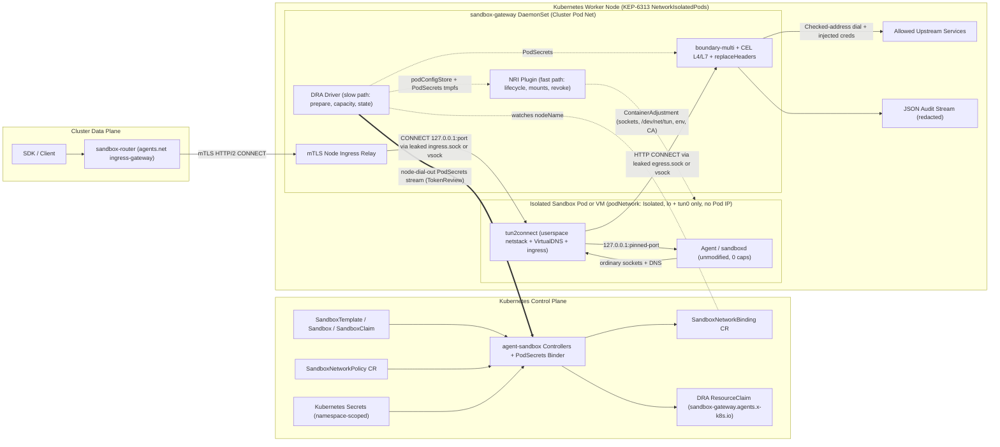
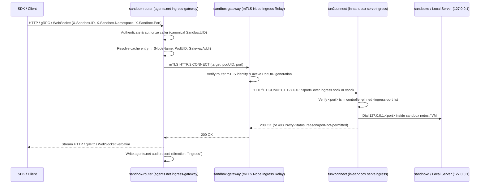

# KEP-NNNN: Sandbox Gateway — Isolated Sandbox Networking with Network-Isolated Pods, DRA, NRI, and agents.net

**Authors:** @aojea

<!--
Rename NNNN to the GitHub tracking issue number when filed.
TOC is auto-generated via `make toc-update`.
-->

<!-- toc -->
- [Summary](#summary)
- [Motivation](#motivation)
  - [Goals](#goals)
  - [Non-Goals](#non-goals)
- [Proposal](#proposal)
  - [User Stories](#user-stories)
  - [High-Level Design](#high-level-design)
    - [1. Three-Layer Architecture](#1-three-layer-architecture)
    - [2. DRA as a PodSpec Extension Layer + NRI Lifecycle Control (The DraNet Split)](#2-dra-as-a-podspec-extension-layer--nri-lifecycle-control-the-dranet-split)
    - [3. How <code>sandbox-gateway</code> Leaks the Proxy and Redirects Traffic with <code>tun2connect</code>](#3-how-sandbox-gateway-leaks-the-proxy-and-redirects-traffic-with-tun2connect)
      - [Node-Side Lifecycle in <code>sandbox-gateway</code>](#node-side-lifecycle-in-sandbox-gateway)
      - [Confinement Modes (<code>ConfinementMode</code>): Native KEP-6313 vs. Backward-Compatible Deny-All <code>NetworkPolicy</code>](#confinement-modes-confinementmode-native-kep-6313-vs-backward-compatible-deny-all-networkpolicy)
      - [Sandbox Attachment Modes (<code>AdapterMode</code>)](#sandbox-attachment-modes-adaptermode)
    - [4. DNS Configuration for Isolated Sandboxes](#4-dns-configuration-for-isolated-sandboxes)
    - [5. Ingress: <code>sandbox-router</code> to Isolated Pods via <code>sandbox-gateway</code> and <code>tun2connect</code>](#5-ingress-sandbox-router-to-isolated-pods-via-sandbox-gateway-and-tun2connect)
    - [6. Policy Control Plane: Baseline Policy + WarmPool Late Binding](#6-policy-control-plane-baseline-policy--warmpool-late-binding)
    - [API Changes](#api-changes)
      - [1. New API Group <code>network.agents.x-k8s.io/v1alpha1</code>](#1-new-api-group-networkagentsx-k8siov1alpha1)
      - [2. Minimal Extensions to Existing <code>agent-sandbox</code> CRDs](#2-minimal-extensions-to-existing-agent-sandbox-crds)
      - [Example Manifests](#example-manifests)
    - [Implementation Guidance](#implementation-guidance)
      - [Stage 1: Controller Confinement Support (<code>NetworkPolicyDenyAll</code> Today + KEP-6313 <code>PodNetworkIsolated</code> on 1.38+)](#stage-1-controller-confinement-support-networkpolicydenyall-today--kep-6313-podnetworkisolated-on-138)
      - [Stage 2: Policy CRDs, Controller Binding, and <code>sandbox-gateway</code> DaemonSet (DRA + NRI + Egress)](#stage-2-policy-crds-controller-binding-and-sandbox-gateway-daemonset-dra--nri--egress)
      - [Stage 3: Isolated Ingress (<code>sandbox-router</code> + <code>sandbox-gateway</code> Node Ingress Relay + <code>tun2connect</code>)](#stage-3-isolated-ingress-sandbox-router--sandbox-gateway-node-ingress-relay--tun2connect)
      - [Stage 4: Embedded L7 Inspection + <code>service-portals</code> Credential Injection, MicroVMs (<code>vsock</code>), gVisor, and High-Scale Binding Stream](#stage-4-embedded-l7-inspection--service-portals-credential-injection-microvms-vsock-gvisor-and-high-scale-binding-stream)
- [Scalability](#scalability)
  - [API Server and Control-Plane Load](#api-server-and-control-plane-load)
  - [Node Resource Footprint (CPU, Memory, PIDs, FDs)](#node-resource-footprint-cpu-memory-pids-fds)
  - [Security and Threat-Model Summary](#security-and-threat-model-summary)
- [Alternatives](#alternatives)
<!-- /toc -->

## Summary

This KEP defines **`sandbox-gateway`**, a fail-closed networking architecture for `agent-sandbox` built from three composable primitives:

1. **Pod Network Confinement — Native KEP-6313 ([KEP-6313](https://kep.k8s.io/6313), [kubernetes/kubernetes#143280](https://github.com/kubernetes/kubernetes/pull/143280)) with Backward-Compatible Deny-All `NetworkPolicy`:** On Kubernetes 1.38+, Sandbox Pods set `spec.podNetwork: Isolated`, giving each Pod a loopback-only network namespace with no default pod network attachment, no `status.podIPs`, no Service/EndpointSlice inclusion, and fail-closed node scheduling via `NodeDeclaredFeatures`. On Kubernetes 1.36–1.37 clusters that do not yet have KEP-6313, an explicit backward-compatible `NetworkPolicyDenyAll` confinement mode isolates the Pod with a controller-managed deny-all Kubernetes `NetworkPolicy` (`ingress: []`, `egress: []`) plus `NRI RunPodSandbox` `eth0` route removal—both applied during `RunPodSandbox` before any container in the Pod can start—so the entire `sandbox-gateway` + `tun2connect` + CEL + ingress stack runs today and upgrades seamlessly to `podNetwork: Isolated`.
2. **DRA + NRI in one node DaemonSet** (following [DraNet](https://github.com/kubernetes-sigs/dranet) and [gke-labs/service-portals#248](https://github.com/gke-labs/service-portals/pull/248)): `sandbox-gateway` runs as a per-node **DaemonSet** that uses **DRA** as the PodSpec extension and scheduling front end (one shared consumable-capacity device per node with `allowMultipleAllocations: true`, fail-closed `NodePrepareResources` before `createPodSandbox`, device-taint health signaling, no node taints) and **NRI** (`RunPodSandbox`, `CreateContainer`, `StopPodSandbox`, `RemovePodSandbox`, `Synchronize`) for direct, in-memory Pod and container lifecycle control—writing zero CDI JSON files to disk.
3. **The [`agents.net`](https://github.com/aojea/agents.net) specification and `tun2connect`:** Because Linux network interfaces belong to a network namespace (one per Kubernetes Pod, not one per container), `sandbox-gateway` hosts one `agents.net` HTTP `CONNECT` boundary listener (`boundary-multi`) per Pod and **leaks that dedicated proxy channel into the Pod's single `tun2connect` native sidecar (via NRI `CreateContainer` bind mounts) or microVM guest (via per-VM `vsock`)**. Inside the Pod network namespace or VM, **`tun2connect`** from `agents.net` creates one `tun0` device, makes it the Pod's default route, answers DNS locally with synthetic addresses, redirects all TCP (and optional UDP) traffic from every container in the Pod to the leaked proxy socket as named HTTP `CONNECT` tunnels, and serves `agents.net` reverse-channel ingress (`CONNECT 127.0.0.1:<port>`) for pinned local ports.

Because `tun2connect` runs inside the sandbox and talks over a leaked per-sandbox UDS or `vsock` channel, **`sandbox-gateway` creates zero `veth` pairs, zero proxy network namespaces, and zero iptables/nftables rules on the host**. Containers and microVMs share one uniform data plane, policy descriptor, audit record, and ingress wire.

Because isolated Pods have no Pod IP and no Service endpoints, `sandbox-router` acts as an `agents.net` ingress gateway. It authenticates callers and opens mTLS `HTTP/2 CONNECT` tunnels to `sandbox-gateway`'s Node Ingress Relay, which dials the sandbox's leaked ingress socket (or `vsock` port) and hands streams to `tun2connect` for delivery to `127.0.0.1:<port>` (`sandboxd` or application servers).

Policy binding supports both a **template/DRA baseline policy** for cold-start Sandboxes and **late-bound claim-time policy overrides** for `SandboxWarmPool` adoption, while keeping unclaimed warm Sandboxes strictly default-deny. For L7 HTTP / JSON-RPC 2.0 rules and provider API credentials, `sandbox-gateway` embeds the host-held credential injection model from [`gke-labs/service-portals`](https://github.com/gke-labs/service-portals) directly inside its boundary (`replaceHeaders` replace-only-if-present rules referencing `secret://<name>` plus a separate `TokenReview`-authenticated node-dial-out `PodSecrets` stream), keeping one interception wire, one node DaemonSet, and zero raw secrets inside sandboxes, `SandboxNetworkPolicy`, or `SandboxNetworkBinding`.

## Motivation

`agent-sandbox` runs untrusted, often model-generated code at high density and churn. Today, `SandboxTemplate` enforces network isolation by generating a shared Kubernetes `NetworkPolicy` (`extensions/controllers/sandboxtemplate_controller.go`) and overriding `dnsConfig` with public resolvers (`8.8.8.8`, `1.1.1.1`) in `extensions/controllers/utils.go`.

That CNI + `NetworkPolicy` model has structural flaws for agentic workloads:

1. **Policy-creation and async-CNI ordering gaps.** CNIs that apply `NetworkPolicy` synchronously during `RunPodSandbox` prevent containers from running before existing policies apply, but `SandboxTemplateReconciler` creates the shared `NetworkPolicy` asynchronously relative to Pod creation—and CNIs that reconcile policies asynchronously after `CNI ADD` can still leave a fail-open window on ephemeral sandboxes ([#2371](https://github.com/kubernetes-sigs/agent-sandbox/issues/2371)). By contrast, KEP-6313 and `sandbox-gateway`'s `NRI RunPodSandbox` hook enforce isolation synchronously during `RunPodSandbox`, before any container in the Pod can start.
2. **Additive policies widen access silently.** Any broad `NetworkPolicy` in the same namespace silently overrides a template's default-deny rules because Kubernetes `NetworkPolicy` rules are additive.
3. **IP-only L3/L4 filtering breaks for modern APIs.** Agents call model APIs, package registries, and Git hosts behind shared CDNs and anycast IPs. L4 CIDR rules either over-permit (`0.0.0.0/0`) or break when upstream IPs rotate.
4. **DNS exfiltration side channel.** Allowing UDP/TCP port 53 to CoreDNS or public resolvers lets an agent exfiltrate data through encoded DNS queries while L4 checks stay green.
5. **Per-sandbox CNI and IPAM overhead.** Every sandbox consumes a cluster Pod IP, runs CNI `ADD`/`DEL`, and generates EndpointSlice churn even though the sandbox never needs cluster-flat pod networking.
6. **Host-netfilter and CNI conflicts.** Chained CNIs collide with managed dataplanes (Cilium / GKE Dataplane V2), and host-side `iptables`/`nftables` interception couples the sandbox proxy to host routing, bridging, conntrack, and runtime-specific `veth`/`tap` plumbing.
7. **WarmPool policy mismatch and credential leakage.** Warm pools pre-create Pods before a `SandboxClaim` assigns a tenant. Static pod specs cannot bind per-claim egress policies or keep reusable provider credentials outside the sandbox ([#818](https://github.com/kubernetes-sigs/agent-sandbox/issues/818), [#1045](https://github.com/kubernetes-sigs/agent-sandbox/issues/1045)).

Combining KEP-6313 (`spec.podNetwork: Isolated`), a DRA + NRI `sandbox-gateway` DaemonSet leaking a per-sandbox proxy socket, and `tun2connect` from `agents.net` removes the default network first, keeps untrusted packet translation inside the sandbox, and gives `sandbox-gateway` direct lifecycle control without writing CDI files to disk.

### Goals

- Make `agent-sandbox` core controllers (`Sandbox`, `SandboxTemplate`, `SandboxClaim`, `SandboxWarmPool`) first-class compatible with KEP-6313 `spec.podNetwork: Isolated` Pods that have no `status.podIPs` and no Service endpoints, while providing an explicit backward-compatible `NetworkPolicyDenyAll` confinement mode so `sandbox-gateway` works immediately on Kubernetes 1.36–1.37 clusters with a NetworkPolicy-enforcing CNI.
- Introduce **`sandbox-gateway`**, a per-node DaemonSet combining a DRA driver (`sandbox-gateway.agents.x-k8s.io`), an NRI plugin, an `agents.net` `boundary-multi` egress proxy, and an mTLS Node Ingress Relay.
- Use **DRA** as a typed, RBAC-governed, fail-closed PodSpec extension and scheduling front end with one shared consumable-capacity device per node and no node taints.
- Use **NRI** (`Synchronize`, `RunPodSandbox`, `CreateContainer`, `StopPodSandbox`, `RemovePodSandbox`) for direct, in-memory Pod and container lifecycle control—injecting socket mounts, `/dev/net/tun`, env vars, and CA bundles via `ContainerAdjustment` with zero CDI files written to disk.
- Leak a dedicated, access-controlled proxy channel into each isolated Pod (mounted into its single `tun2connect` native sidecar via NRI `CreateContainer`) or microVM (per-VM `vsock` channel), and redirect all Pod TCP (and optional UDP) traffic through one **`tun2connect`** instance per Pod network namespace with zero host netfilter rules and zero host `veth` plumbing.
- Support unmodified agent container images via one minimal `tun2connect` native sidecar per Pod (primary container mode, sharing the Pod network namespace while leaving all agent containers with zero capabilities), one in-guest `tun2connect` per microVM over `vsock`, and an explicit proxy fallback (`ExplicitProxy`) where TUN is unavailable.
- Support both baseline policies (on `SandboxTemplate` / DRA parameters) and late-bound per-claim policy overrides on `SandboxClaim` (safe for `SandboxWarmPool` adoption, with unclaimed warm pods locked to default-deny).
- Embed `gke-labs/service-portals`'s host-held credential injection model (`replaceHeaders` replace-only-if-present rules referencing `secret://<name>`, delivered per `PodUID` over a separate `TokenReview`-authenticated node-dial-out `PodSecrets` stream) and L7 `http`/`jsonrpc` CEL inspection directly inside `sandbox-gateway` (Stage 4), keeping raw credentials out of sandboxes, policy CRDs, persistent disk, and audit logs.
- Preserve full `sandbox-router` and SDK compatibility (HTTP/1.1, WebSockets, native gRPC, gRPC-Web, `sandboxd`, and existing `X-Sandbox-*` / authz contracts) for IP-less isolated Sandboxes via `sandbox-gateway`'s Node Ingress Relay and `tun2connect`'s built-in `agents.net` ingress listener.
- Leave existing non-isolated Sandboxes (`podNetwork` unset or `Default`) completely unchanged and backward-compatible.

### Non-Goals

- Deprecating or removing default-network `Sandbox` support or `SandboxTemplate` CNI `NetworkPolicy` management for clusters predating Kubernetes 1.38 or `NetworkIsolatedPods`.
- Building a general-purpose multi-network CNI or managing host-root `iptables`/`nftables` rules.
- Managing CDI JSON specification files on node filesystems (`/etc/cdi` or `/var/run/cdi`).
- Building a general-purpose secret manager, KMS, or OAuth token broker; `sandbox-gateway` injects credentials resolved from existing Kubernetes `Secret`s (or external secret syncers such as External Secrets Operator) without storing raw secret material in policy CRDs or giving node DaemonSets ambient access to cluster Secrets.
- Blocking Stage 2 L4/DNS confinement on L7 TLS termination or credential injection: L4/DNS CEL confinement ships first in Stage 2, and embedded L7 (`http`/`jsonrpc`) inspection plus `PodSecrets` credential injection ship on the same `sandbox-gateway` wire in Stage 4.
- Proposing new core `PodSpec` fields beyond KEP-6313 (`spec.podNetwork`).
- Supporting `hostNetwork: true` sandboxes or `hostPort` / kubelet network probes (`httpGet`, `tcpSocket`, `grpc`), which KEP-6313 forbids on isolated Pods.

## Proposal

### User Stories

- **Security engineer running untrusted coding agents:** I want every sandbox to start with no route to the cluster network, metadata service, or internet. Ordinary TCP tools (`pip`, `npm`, `git`, `ssh`, `curl`, database drivers) must work without honoring `HTTP_PROXY`, fail closed if `sandbox-gateway` restarts, revoke active connections immediately when a Pod stops, and produce one JSON audit record per destination decision.
- **Platform operator running containers and microVMs:** I want one DaemonSet (`sandbox-gateway`), one policy CRD, and one audit format across both Linux containers and Kata/Firecracker microVMs, without touching host CNI conflists, host root netfilter tables, or on-disk CDI spec files.
- **WarmPool operator serving multi-tenant claims:** I keep 500 warm sandboxes ready per template. While unclaimed, a warm sandbox must have zero egress. When a user creates a `SandboxClaim` with a task-specific allowlist, `sandbox-gateway` must bind that policy before the claim reports `Ready=True` without restarting the Pod.
- **SDK and `sandboxd` user:** I want `clients/go`, `k8s-agent-sandbox` (Python), and the TypeScript SDK to run commands and transfer files through `sandbox-router` against isolated, IP-less sandboxes using the exact same client calls as today.
- **Application developer using unmodified images:** I do not want to bake `tun2connect`, proxy variables, or CA certificates into every agent container image.

### High-Level Design

#### 1. Three-Layer Architecture



Each layer owns one clearly bounded responsibility:

| Layer | Mechanism | Responsibility | Failure Behavior |
| --- | --- | --- | --- |
| **Confinement** | Native (K8s 1.38+): KEP-6313 (`spec.podNetwork: Isolated`)<br>Compat (K8s 1.36–1.37): Deny-All `NetworkPolicy` + NRI `eth0` route strip | Native: creates pod netns with `lo` only, skips CNI `ADD`/`DEL`, enforces empty `status.podIPs`, excludes from Services/Endpoints.<br>Compat: blocks all `eth0` ingress/egress via `NetworkPolicy` (`ingress: []`, `egress: []`) and strips `eth0` routes in `NRI RunPodSandbox` | Native: fail closed via `NodeDeclaredFeatures` (`NetworkIsolatedPods`) and kubelet admission (`PodFeatureUnsupported`).<br>Compat: requires a NetworkPolicy-enforcing CNI; NRI errors abort `RunPodSandbox` |
| **PodSpec Extension & Scheduling** | DRA (`DeviceClass`, `ResourceSlice`, `ResourceClaim`, consumable capacity, device taints) | Declares opt-in and `SandboxGatewayParameters`, schedules only onto healthy nodes with capacity, executes slow-path `NodePrepareResources` before `createPodSandbox` | Fail closed: Pod stays `Pending` if no healthy node slice exists; kubelet aborts sandbox creation if `NodePrepareResources` fails |
| **Runtime Lifecycle & Channel Leak** | NRI (`Synchronize`, `RunPodSandbox`, `CreateContainer`, `StopPodSandbox`, `RemovePodSandbox`) | Verifies loopback-only netns, leaks per-sandbox `egress.sock`/`ingress.sock` (or VM `vsock`), `/dev/net/tun`, env vars, and CA certs directly in memory; recovers live pods on restart; revokes tunnels and wipes `PodSecrets` immediately on stop | Fail closed: NRI errors abort `RunPodSandbox` or `CreateContainer`; `StopPodSandbox` immediately closes active tunnels and wipes secrets |
| **In-Sandbox Redirection** | `tun2connect` from `agents.net` | Refuses to start if any non-loopback interface exists; creates `tun0`, drops `CAP_NET_ADMIN`, answers virtual DNS, forwards all TCP/UDP as HTTP `CONNECT`, serves pinned ingress | Fail closed: if `tun2connect` exits, the sandbox has no other route |
| **Authorization, L7 Policy & Credential Injection** | `sandbox-gateway` (`agents.net` `boundary-multi` + embedded CEL L4/L7 + `service-portals` `PodSecrets`/`replaceHeaders`) | Enforces per-listener default-deny CEL policy (L4/DNS + optional L7 `http`/`jsonrpc`), resolves DNS outside the sandbox, filters RFC 6890 addresses, replaces placeholder headers from node-held `PodSecrets`, writes redacted JSON audit records | Fail closed: missing policy or secret returns `503` (placeholder never forwarded); denied destination/method returns `403` with RFC 9209 `Proxy-Status` |
| **Inbound Access** | `sandbox-router` + `sandbox-gateway` Node Ingress Relay + `tun2connect` ingress | Authenticates and authorizes callers and delivers streams to pinned loopback ports (`127.0.0.1:<port>`) without a Pod IP | Fail closed: unpinned ports return `403 port-not-permitted`; revoked Pod UIDs/generations are rejected |

#### 2. DRA as a PodSpec Extension Layer + NRI Lifecycle Control (The DraNet Split)

Adding a new networking or runtime field directly to core `v1.PodSpec` (for example `spec.captureAllMyNetworkTraffic` or custom egress/DNS fields) takes multiple Kubernetes release cycles, requires API server and client skew handling across every workload controller, and couples core Kubernetes to runtime-specific behaviors.

DRA (GA in Kubernetes 1.34, with `DRAConsumableCapacity` beta/default-on in 1.36, and `DRAExtendedResource` and `DRADeviceTaints` GA in 1.37) provides a general-purpose, typed extension mechanism for `PodSpec`. Pairing DRA with NRI follows the production-proven split established by [DraNet](https://github.com/kubernetes-sigs/dranet) (`pkg/driver/dra_hooks.go` and `pkg/driver/nri_hooks.go`):

1. **One shared device per node with consumable capacity (`DRAConsumableCapacity`).** Following [gke-labs/service-portals#248](https://github.com/gke-labs/service-portals/pull/248), `sandbox-gateway` publishes **one** shared device per node in its `ResourceSlice` with `allowMultipleAllocations: true` and a `sandboxes` capacity using `requestPolicy: {default: "1", validValues: ["1"]}` (for example `value: "250"`). Every Pod allocation automatically consumes 1 slot from that node's budget without fake static device pools (`gw-0`, `gw-1`, ...), and optional capacities (such as `connections` with a `validRange`) can be added on the same device.
2. **Simple default opt-in via `DRAExtendedResource`, with `ResourceClaimTemplate` for overrides.** Setting `spec.extendedResourceName: agents.x-k8s.io/sandbox-gateway` on the `DeviceClass` (alongside cluster-default `SandboxGatewayParameters` in `spec.config`) lets simple Pods and templates opt in with a single line in `resources.limits["agents.x-k8s.io/sandbox-gateway"]: "1"`—with **zero** per-namespace `ResourceClaimTemplate` objects required. Templates that customize per-template `SandboxGatewayParameters` (such as custom `adapterMode`, `ingressPorts`, or `caTrustMode`) attach a `ResourceClaimTemplate` referencing the same `DeviceClass`.
3. **Fail-closed scheduling, health taints, and zero-downtime restarts (`DRADeviceTaints`).** A Pod requesting `sandbox-gateway.agents.x-k8s.io` schedules only to nodes whose `sandbox-gateway` DaemonSet has published a healthy, non-tainted `ResourceSlice`. If the proxy becomes unhealthy, `sandbox-gateway` adds a `DeviceTaint` (`effect: NoSchedule`) to its device—and operators can apply cluster-wide drains via `DeviceTaintRule`—without touching `Node.spec.taints`. On the node, kubelet runs `PrepareDynamicResources` (`NodePrepareResources`) in `SyncPod` **before** calling CRI `RunPodSandbox`. If `sandbox-gateway` is restarting or down, kubelet holds the Pod in `ContainerCreating` until `sandbox-gateway` recovers instead of letting it miss NRI `CreateContainer` and `CrashLoopBackOff`.
4. **Slow path in DRA, fast path in NRI.** Container runtime NRI hooks have tight timeouts (default 2 seconds). Following DraNet, `sandbox-gateway` puts every slow operation (API/policy resolution, socket directory creation, `boundary-multi` listener startup, readiness probe, and persistent `podConfigStore` write) inside DRA `NodePrepareResources`. The NRI hooks simply read from `podConfigStore` in memory and execute in milliseconds.
5. **Why NRI is simpler and stronger than CDI here:**
   - **Zero CDI files on disk:** `sandbox-gateway` never generates, watches, or cleans up `/var/run/cdi/*.json` specs across crashes or reboots. Mounts, `/dev/net/tun`, env vars, and CA certs are injected directly in memory via `api.ContainerAdjustment`.
   - **Full Pod lifecycle control:** NRI `Synchronize` hands `sandbox-gateway` the exact list of live sandboxes and containers after a DaemonSet restart; `RunPodSandbox` runs once per Pod before any container starts (allowing netns verification and KEP-4817 `ResourceClaim.status.devices` updates); `StopPodSandbox` revokes active flows immediately instead of waiting for kubelet `NodeUnprepareResources`.
   - **Per-container precision across every container:** `CreateContainer` sees init containers, sidecars, main containers, and ephemeral containers regardless of whether every container repeated `resources.claims`. `sandbox-gateway` mounts the proxy sockets and `/dev/net/tun` **only** into the `tun2connect` container while injecting `AGENT_CA_CERT` into **every** container in the Pod.
   - **Same privilege boundary:** Both a DRA kubelet plugin and an NRI plugin require a privileged per-node DaemonSet, and NRI is enabled by default in containerd 2.0+ (and CRI-O), running in front of `runc`, `gVisor`, and `Kata` shims.
6. **Clear split between Core `PodSpec`, DRA, NRI, and Late-Bound Policy:**
   - **Core `PodSpec` (`spec.podNetwork: Isolated`)** owns the safety invariant kubelet, CRI, and core controllers enforce even when no driver runs (skip CNI, forbid network probes and `hostPort`, enforce empty `status.podIPs`, exclude from Endpoints).
   - **DRA (`DeviceClass` + `ResourceSlice` + `DRAExtendedResource`/`ResourceClaim`)** owns node capability matching, consumable capacity, device-taint health signaling, fail-closed prepare/unprepare lifecycle, and static plumbing defaults (`SandboxGatewayParameters`).
   - **NRI (`sandbox-gateway` runtime plugin)** owns in-memory container/pod lifecycle injection, restart synchronization, and immediate teardown revocation.
   - **Controller-managed binding (`SandboxNetworkBinding`)** owns mutable per-claim egress policy and generation revocation for WarmPools. Because `ResourceClaim` allocation is immutable after Pod creation, binding claim-level policy outside the Pod spec prevents confused-deputy bugs where pod metadata selects its own policy or credentials.

**DRA Feature Matrix (all below KEP-6313's Kubernetes 1.38 floor):**

| DRA Feature | Used For |
| --- | --- |
| Core DRA (`resource.k8s.io/v1`, GA 1.34) | `DeviceClass`, `ResourceSlice`, `ResourceClaim`, fail-closed `NodePrepareResources` before `RunPodSandbox` |
| `DRAConsumableCapacity` (default-on 1.36+) | One shared device per node (`allowMultipleAllocations: true`) with per-sandbox `sandboxes` capacity (`requestPolicy.default: "1"`) |
| `DRAExtendedResource` (1.37+) | Simple single-line Pod opt-in (`resources.limits["agents.x-k8s.io/sandbox-gateway"]: "1"`) with no per-namespace `ResourceClaimTemplate` |
| `DRADeviceTaints` (1.37+) | Self-tainting unhealthy `sandbox-gateway` devices (`NoSchedule`) and operator `DeviceTaintRule` drains without `Node.spec.taints` |
| `DRAResourceClaimDeviceStatus` / KEP-4817 | Publishing `sandbox-gateway`'s per-node ingress endpoint metadata on `ResourceClaim.status.devices` |

#### 3. How `sandbox-gateway` Leaks the Proxy and Redirects Traffic with `tun2connect`

##### Node-Side Lifecycle in `sandbox-gateway`

1. **DRA `NodePrepareResources(claimUID, podUID)`** *(slow path, runs before `RunPodSandbox`)*:
   - Creates two isolated per-sandbox subdirectories on a node-local memory-backed tmpfs (`/run/sandbox-gateway`, root dir mode `0700` owned by `sandbox-gateway`, outside any hostPath reachable by sandboxes):
     - `/run/sandbox-gateway/<podUID>/egress/` — holds `egress.sock`, created and owned by `sandbox-gateway`. Mounted **read-only** into `tun2connect` so the sandbox can `connect()` to the socket (`agents.net` `isolation.md §2`) but cannot unlink or replace it.
     - `/run/sandbox-gateway/<podUID>/ingress/` — dedicated per-sandbox directory where `tun2connect` creates `ingress.sock` (container mode). `sandbox-gateway` verifies `S_ISSOCK` with `O_NOFOLLOW` before dialing so a compromised workload cannot plant a symlink to another host socket.
     - For **microVMs** (Kata / Firecracker), `sandbox-gateway` binds that VM's dedicated host `vsock` channel (Firecracker `<uds_path>_<egress-port>` or host `AF_VSOCK` CID mapping per `agents.net` `identity.md §6`) and records the VM's ingress `vsock` port.
   - Starts a dedicated listener in `boundary-multi` on `egress/egress.sock` (or the VM's egress `vsock` socket), bound strictly to `podUID` (listener-bound identity: guest headers such as `Sandbox-Id` never select policy).
   - Loads either the template baseline policy descriptor (when `policyBindingMode: Static`) or an empty default-deny / `policy-unavailable` descriptor (when `policyBindingMode: Dynamic`, including all unclaimed WarmPool pods).
   - Verifies boundary readiness per `agents.net` `isolation.md §6.1` (a probe `CONNECT` to a denied destination receives `403` or `503 policy-unavailable` rather than a connection error).
   - Persists `podUID -> SandboxConfig` in `podConfigStore` (BoltDB / tmpfs under `/run/sandbox-gateway/state/`, matching DraNet's `pod_device_config_bolt.go`) so DaemonSet restarts recover active pods without writing state to persistent disk.
   - Returns an empty CDI device list (no CDI files written to disk).
2. **CRI `RunPodSandbox`** *(KEP-6313)*:
   - Container runtime creates the isolated network namespace with only `lo` up (`127.0.0.1/8`, `::1/128`), skips CNI `ADD`, and reports no Pod IPs.
3. **NRI `RunPodSandbox`** *(fast path, runs synchronously once per Pod before any container is created or started)*:
   - Looks up `pod.Uid` in `podConfigStore`. Pods without a prepared claim are untouched; pods with a prepared claim must pass all checks or `RunPodSandbox` returns an error (fail closed, preventing any container in the Pod from starting).
   - Inspects the Pod network namespace (`getNetworkNamespace(pod)`):
     - Under **`confinementMode: PodNetworkIsolated`** (K8s 1.38+): verifies the netns contains **only loopback** (confirming KEP-6313 isolation held; fails closed if any non-loopback CNI interface is present).
     - Under **`confinementMode: NetworkPolicyDenyAll`** (K8s 1.36–1.37 compat): flushes `eth0` routes in the Pod netns during `RunPodSandbox` alongside the controller-managed deny-all Kubernetes `NetworkPolicy` (which enforcing CNIs also apply during `RunPodSandbox`). Because `RunPodSandbox` finishes before CRI creates or starts any container, no container can ever run before network isolation is active; leaving the `eth0` link intact keeps kubelet status and CNI `DEL` working cleanly.
   - Records the runtime sandbox ID and netns path in `podConfigStore` and publishes `ResourceClaim.status.devices` (KEP-4817) with `sandbox-gateway`'s ingress endpoint metadata.
4. **NRI `CreateContainer`** *(fast path, per container in the Pod)*:
   - Looks up `pod.Uid` in `podConfigStore` and builds an in-memory `api.ContainerAdjustment`:
     - **In `TunSidecar` mode — ONLY the Pod's single `tun2connect` native sidecar container** (because Linux network interfaces belong to the Pod's shared network namespace, there is always at most **one** `tun2connect` / `tun0` per Pod, never per container):
       - `AddMount`: `/run/sandbox-gateway/<podUID>/egress` → `/run/agents.net/egress` (`ro,bind`)
       - `AddMount`: `/run/sandbox-gateway/<podUID>/ingress` → `/run/agents.net/ingress` (`rw,bind`, when `ingressPorts` is non-empty)
       - `AddDevice`: `/dev/net/tun` (`c`, major 10, minor 200) and transient `CAP_NET_ADMIN` + `CAP_SETPCAP` (which `tun2connect` drops immediately after creating `tun0`)
       - `AddEnv`: `AGENTS_NET_EGRESS_SOCKET`, `AGENTS_NET_INGRESS_SOCKET`, `AGENTS_NET_INGRESS_PORTS` (and `AGENTS_NET_COMPAT_ISOLATED=1` under `NetworkPolicyDenyAll`)
     - **In `ExplicitProxy` mode** (no TUN device): leaks `/run/sandbox-gateway/<podUID>/egress` (`ro,bind`) and sets `HTTP_PROXY`/`HTTPS_PROXY`/`ALL_PROXY` on workload containers.
     - **All containers in the Pod** (when `caTrustMode != None`):
       - `AddMount`: read-only CA certificate at `/var/run/agent-ca.pem`
       - `AddEnv` (when `caTrustMode == InjectEnv`): `AGENT_CA_CERT`, `SSL_CERT_FILE`, `REQUESTS_CA_BUNDLE`, `NODE_EXTRA_CA_CERTS`.
     - **Untrusted agent containers in `TunSidecar` mode:** receive **neither** `/dev/net/tun` **nor** the `/run/agents.net/` socket mounts! They share the Pod network namespace (`lo` + the sidecar's single `tun0`) and receive only the optional CA cert.
5. **In-Sandbox Traffic Redirection (`tun2connect`):**
   - In `PodNetworkIsolated` mode, `tun2connect` inspects network interfaces and **refuses to start** if any interface other than `lo` exists (`agents.net/sdk/cmd/tun2connect/run.go:90-99`). In explicit `NetworkPolicyDenyAll` compat mode, NRI passes `-compat-isolated` (replacing any residual default route with `tun0`, never enabled by default so misconfigured KEP-6313 pods still fail closed).
   - Opens `/dev/net/tun` to create `tun0`, assigns the reserved synthetic-pool addresses (`100.127.255.254/10` IPv4 and `100::ffff:ffff:ffff:fffe/64` IPv6), brings `tun0` up, and installs default routes (`0.0.0.0/0` and `::/0`) through `tun0`.
   - Drops `CAP_NET_ADMIN` from all threads and the capability bounding set (`dropNetAdmin()` in `run.go:156-176`) before any workload traffic flows, refusing to continue if the drop fails.
   - Runs gVisor's userspace TCP/IP stack (`netstack`) and `VirtualDNS` inside the sandbox:
     - Every UDP port 53 query (regardless of destination IP) is answered locally with a synthetic address from `100.64.0.0/10` or `100::/64` (top `/24` and `/120` reserved).
     - Every outbound TCP connection (and optional UDP session via RFC 9298 `connect-udp`) becomes an HTTP `CONNECT` request carrying the original hostname (or literal IP if no mapping exists) + port over `/run/agents.net/egress/egress.sock` (or `vsock://2:<egress-port>`).
     - Denied connections fail before the guest TCP handshake completes (or reset immediately), and every decision emits one JSON audit record on `sandbox-gateway`.
   - Starts `serveIngress` on `/run/agents.net/ingress/ingress.sock` (or `vsock://<ingress-port>`) for the controller-pinned ports.
6. **NRI `Synchronize`** *(on `sandbox-gateway` DaemonSet restart)*:
   - Containerd delivers the list of live `PodSandbox`es and `Container`s. `sandbox-gateway` reconciles `podConfigStore` against live sandboxes, restores active `boundary-multi` listeners (including compiled CEL policies and active `PodSecrets` from `/run/sandbox-gateway/state/` and `/run/sandbox-gateway/secrets/` tmpfs), and reaps orphaned entries and secrets for pods that disappeared during downtime.
7. **Teardown (`NRI StopPodSandbox` / `RemovePodSandbox` + `DRA NodeUnprepareResources`):**
   - On `StopPodSandbox` (immediate, before kubelet garbage collection): `sandbox-gateway` closes the sandbox's `boundary-multi` listener, terminates every active egress tunnel, pending upstream dial, and active ingress relay, immediately zeros and deletes that Pod's `PodSecrets` from memory and `/run/sandbox-gateway/secrets/` tmpfs, and marks the binding `Revoked`.
   - On `RemovePodSandbox` / `NodeUnprepareResources`: removes `/run/sandbox-gateway/<podUID>/` and deletes the `podConfigStore` entry.

##### Confinement Modes (`ConfinementMode`): Native KEP-6313 vs. Backward-Compatible Deny-All `NetworkPolicy`

Because KEP-6313 (`spec.podNetwork: Isolated`) lands as Alpha in Kubernetes 1.38, `sandbox-gateway` supports two explicit confinement modes (no silent auto-downgrade, so security posture is always auditable):

| Property | `PodNetworkIsolated` (K8s 1.38+, Recommended) | `NetworkPolicyDenyAll` (K8s 1.36–1.37 Compat) |
| --- | --- | --- |
| **Pod network attachment** | None (`lo` only; CNI `ADD`/`DEL` skipped; empty `status.podIPs`) | Default CNI `eth0` attached, blocked by controller-managed deny-all `NetworkPolicy` (`policyTypes: [Ingress, Egress]`, empty `ingress: []`, empty `egress: []`) |
| **Enforcement timing (`RunPodSandbox`)** | Applied synchronously during `RunPodSandbox` (no `eth0` exists; `NRI RunPodSandbox` verifies `lo`-only before any container starts) | Applied synchronously during `RunPodSandbox` (`NetworkPolicy` applied by enforcing CNIs during `RunPodSandbox` + `NRI RunPodSandbox` flushes `eth0` routes on `runc`), so containers never run before isolation is active |
| **Additive `NetworkPolicy` widening** | Impossible (no pod network attachment; `NetworkPolicy` does not apply) | Residual risk if another `NetworkPolicy` in the same namespace selects the Pod and opens `eth0` (mitigated on `runc` by stripped `eth0` routes, and by namespace isolation / admission policy) |
| **IPAM / EndpointSlice overhead** | Eliminated | Still allocates one Pod IP per sandbox |
| **Ingress path** | `sandbox-router` → `sandbox-gateway` → `ingress.sock` / `vsock` → `tun2connect` | **Identical** (`NetworkPolicy` denies all `eth0` ingress, so `sandbox-router` routes through `sandbox-gateway` using the same wire) |
| **CEL policy, `tun2connect`, DRA, NRI, audit** | Identical | Identical |

##### Sandbox Attachment Modes (`AdapterMode`)

Because Linux network interfaces belong to a network namespace (one shared network namespace per Kubernetes Pod, not per container), there is always **at most one `tun2connect` (`tun0`) per Pod or microVM**. All three modes share the same `sandbox-gateway` DaemonSet (DRA + NRI), `DeviceClass`, `agents.net` boundary proxy, policy CRDs, and audit trail:

| Mode | Where `tun2connect` Runs (1 per Pod / VM) | PodSpec Capabilities (PSA) | Agent Container Visibility | Runtime Fit |
| --- | --- | --- | --- | --- |
| **`TunSidecar`** *(Primary for containers)* | One controller-injected Kubernetes native sidecar per Pod (`initContainers` with `restartPolicy: Always`), sharing the Pod's network namespace and starting before any app container. NRI `CreateContainer` injects sockets, `/dev/net/tun`, and transient `CAP_NET_ADMIN` into the sidecar only (dropped immediately after creating `tun0`). | **Zero in PodSpec (`drop: ["ALL"]`)** when NRI grants transient `CAP_NET_ADMIN` to the sidecar (or explicit sidecar cap if running without OCI cap adjustment); agent images and entrypoints stay unmodified, and multi-container Pods share the single `tun0` seamlessly | Agent containers have **zero caps** and **never mount** `/dev/net/tun` or `/run/agents.net/` sockets | `runc` / `crun`, `gVisor` (with `--host-uds=open`, pending `/dev/net/tun` verification) |
| **`TunVM`** *(Primary for microVMs)* | One in-guest `tun2connect` daemon per microVM (`/sbin/init` or guest system daemon), talking over `vsock://2:<egress-port>` and serving `vsock://<ingress-port>`. | **Zero (`drop: ["ALL"]`)**; passes PSA `restricted` because `tun0` lives inside the guest kernel | Zero host sockets mounted; only per-VM `vsock` ports bound | Kata Containers, Firecracker |
| **`ExplicitProxy`** *(Fallback, no TUN)* | No TUN device. NRI `CreateContainer` leaks the Pod's `egress.sock` (and loopback bridge if needed) and sets `HTTP_PROXY`/`HTTPS_PROXY`/`ALL_PROXY`. Clients ignoring proxy vars hit the isolated netns and fail closed. | **Zero (`drop: ["ALL"]`)**; passes PSA `restricted` with no transient capabilities | Proxy-aware workloads only; direct sockets fail closed | `runc` / `crun`, `gVisor` (`--host-uds=open`) |

**Why keeping `tun2connect` inside the sandbox matters for security:**

- **Host attack surface stays minimal.** Untrusted L3/L4 packet parsing and userspace TCP reassembly (`netstack`) execute inside the untrusted sandbox, not inside the privileged `sandbox-gateway` DaemonSet. The only input `sandbox-gateway` parses from a sandbox is bounded HTTP `CONNECT` request heads (`wire.md §2`).
- **Untrusted adapter invariant holds.** Even if an attacker compromises `tun2connect` or replaces it inside the sandbox, they gain at most the right to send raw `CONNECT` requests over their own `egress.sock`—every request is still validated and authorized by `sandbox-gateway` against the listener's fixed policy descriptor (`isolation.md §3`).

#### 4. DNS Configuration for Isolated Sandboxes

KEP-6313 keeps standard `dnsPolicy` defaults (`ClusterFirst`) and writes `PodSandboxConfig.dns_config` verbatim into `/etc/resolv.conf`. For `sandbox-gateway`-managed isolated Sandboxes:

- `ApplySandboxSecureDefaults` (`extensions/controllers/utils.go`) MUST NOT inject `8.8.8.8` / `1.1.1.1` when `isolatedNetwork` is configured or `podNetwork: Isolated`.
- For `TunSidecar` and `TunVM`, the controller defaults unset `dnsPolicy` to `None` with `dnsConfig.nameservers: ["100.127.255.253"]` (matching `resolverAddr` in `agents.net/sdk/cmd/tun2connect/run.go:42`), empty `searches`, and `enableServiceLinks: false`. Setting `dnsConfig` on the PodSpec ensures every container in the Pod—including read-only, non-root agent containers—gets `/etc/resolv.conf` pointing at the Pod's `tun2connect` virtual DNS without needing to mutate `/etc/resolv.conf` at runtime.
- Even if a workload hardcodes another nameserver (such as `8.8.8.8`), `tun0` is the default route and `tun2connect` answers UDP port 53 locally for any destination address. Real DNS resolution happens exclusively inside `sandbox-gateway` outside the sandbox.
- For `ExplicitProxy`, the controller defaults unset `dnsPolicy` to `None` with empty `dnsConfig` and `enableServiceLinks: false`; clients pass hostnames directly in `CONNECT` requests.

#### 5. Ingress: `sandbox-router` to Isolated Pods via `sandbox-gateway` and `tun2connect`

Isolated Pods have empty `status.podIPs` and are never selected into Kubernetes Services, Endpoints, or EndpointSlices. Today, `sandbox-router` routes traffic only to `Pod.Status.PodIP` (cached via a Pod informer filtered by `status.podIP != ""` in `sandbox-router/cache/cache.go`) or headless Service DNS (`sandbox-router/proxy/resolve.go`).

Because `tun2connect` already implements the `agents.net` reverse-channel ingress protocol (`agents.net/sdk/cmd/tun2connect/run.go:268-425`), ingress works identically for containers and microVMs with **zero changes to `sandboxd`**:



Key design properties of the ingress path:

1. **Zero host ports; standard cluster NetworkPolicy.** `sandbox-gateway` runs on the cluster pod network (`hostNetwork: false`). Its Node Ingress Relay listens on its DaemonSet Pod IP (for example `:18443`) with **mandatory mTLS** accepting only `sandbox-router`'s authenticated identity, backed by a Kubernetes `NetworkPolicy` allowing ingress only from `sandbox-router` Pods.
2. **Reuses `tun2connect`'s existing `agents.net` ingress wire.** `sandbox-gateway` dials `/run/sandbox-gateway/<podUID>/ingress/ingress.sock` (checking `O_NOFOLLOW` and `S_ISSOCK`) or the VM's ingress `vsock` port and sends:
   ```http
   CONNECT 127.0.0.1:<port> HTTP/1.1
   Host: 127.0.0.1:<port>
   ```
   `tun2connect` validates `<port>` against the controller-pinned `-ingress-port` list (returning `403` with `Proxy-Status: ingress; error=http_request_denied; reason=port-not-permitted` for any unpinned port) and relays the raw TCP stream to `127.0.0.1:<port>`. `sandboxd` (`packages/sandboxd/cmd/sandboxd/main.go`) works untouched and can even restrict itself to `--listen-host 127.0.0.1`.
3. **Router cache and resolution updates (`sandbox-router`).**
   - `sandbox-router/cache/cache.go` removes the `status.podIP != ""` field-selector filter when isolated routing is enabled (or indexes `SandboxNetworkBinding` alongside Pods).
   - `cache.Entry` gains `Isolated bool`, `NodeName string`, and `GatewayRelayAddr string` (populated from `SandboxNetworkBinding.status.ingressEndpoint` or `ResourceClaim.status.devices[].networkData` per KEP-4817).
   - `sandbox-router/proxy/resolve.go` adds `SourceSandboxGateway`. When selected, the proxy uses an mTLS `HTTP/2 CONNECT` dialer (`DialContext`) to establish a raw stream through `GatewayRelayAddr` for `(PodUID, Port)`, over which `httpTransport` (HTTP/1.1 + WebSockets) and `grpcTransport` (h2c native gRPC + gRPC-Web) operate unchanged.
   - Because `X-Sandbox-Pod-IP` is absent for isolated sandboxes, existing Go, Python, and TypeScript SDKs route through `sandbox-router` automatically with no breaking client API changes.
4. **Generation fencing and revocation.** Every ingress tunnel carries the canonical `PodUID` resolved from `sandbox-router`'s cache, never from guest headers. On `NRI StopPodSandbox`, deletion, suspension, or replacement, `sandbox-gateway` revokes `PodUID` immediately and closes active ingress tunnels so a stale route can never reach a replacement sandbox (`agents.net` `ingress.md §3`).

#### 6. Policy Control Plane: Baseline Policy + WarmPool Late Binding

To support both cold-start templates and fast `SandboxWarmPool` adoption without mutating immutable `Pod` or `ResourceClaim` specs:

1. **Template baseline (`SandboxTemplate` + DRA `SandboxGatewayParameters`):**
   - A `SandboxTemplate` may reference a `SandboxNetworkPolicy` as its baseline (`spec.isolatedNetwork.policyRef`).
   - For a **direct cold-start `Sandbox`** (not owned by a warm pool), `SandboxReconciler` creates a `SandboxNetworkBinding` with that baseline policy immediately.
   - For an **unclaimed `SandboxWarmPool` Sandbox**, `SandboxReconciler` creates its `SandboxNetworkBinding` with `bindingState: Unclaimed` (compiled to an empty `rules: []` default-deny descriptor). The warm Pod starts up, initializes `tun2connect` and the runtime completely offline, and waits with zero external egress.
2. **Claim-time late binding (`SandboxClaim` adoption):**
   - When a `SandboxClaim` adopts a warm Sandbox:
     - If the claim sets `spec.networkPolicyRef`, the controller checks `SandboxTemplate.spec.isolatedNetwork.claimPolicyOverride` (`Disallowed` by default, `NarrowOnly`, or `Allowed`—mirroring `EnvVarsInjectionPolicy` and `VolumeClaimTemplatesPolicy`):
       - `Disallowed`: rejects any `SandboxClaim` that sets `spec.networkPolicyRef`.
       - `Allowed`: binds a single policy layer containing the claim's referenced `SandboxNetworkPolicy`.
       - `NarrowOnly`: binds **two** policy layers (`[templateBaseline, claimPolicy]`) evaluated with logical **AND** across layers (`eval(templateBaseline, req) && eval(claimPolicy, req)`). Because a boolean conjunction is strictly a subset of the baseline, a claim can never widen access beyond the template baseline without implementing fragile CIDR/suffix/port set-intersection math.
     - If the claim omits `spec.networkPolicyRef`, the controller binds the template's baseline `policyRef` (or keeps default-deny if none is set).
   - The controller updates `SandboxNetworkBinding` (incrementing `spec.generation` and writing the effective CEL `policyLayers`).
   - `sandbox-gateway` watches `SandboxNetworkBinding` objects filtered server-side by `spec.nodeName=<this-node>`. On receiving the new generation:
     - It compiles and type-checks every CEL rule to `bool` with a strict `cel.CostLimit` (modeled after DraNet's `CompilePredicate` in `pkg/filter/filter.go`, except runtime evaluation errors **fail closed** to deny). If compilation fails, it keeps the previous policy (or default-deny) and reports `Ready=False` (`PolicyInvalid`).
     - It swaps the compiled policy programs atomically on the sandbox's dedicated listener in `boundary-multi` (and updates `podConfigStore`).
     - It updates `SandboxNetworkBinding.status` with `observedGeneration`, `ingressEndpoint`, and `Ready=True`.
   - `SandboxReconciler` and `SandboxClaimReconciler` gate `Ready=True` on `SandboxNetworkBinding` reporting `Ready=True` for the current `generation`. A caller never receives a `Ready` Sandbox before its exact egress policy is active in `sandbox-gateway`.
3. **Three-phase CEL evaluation and `agents.net` conformance:**
   - **Phase 1 (Request authorization, before DNS or dial):** `sandbox-gateway` normalizes the `CONNECT` authority (`wire.md §6`) and evaluates each layer's compiled CEL predicates against `{request, sandbox}` (`request.host`, `request.ip`, `request.isLiteral`, `request.port`, `request.transport`, `sandbox.name`, `sandbox.namespace`, `sandbox.labels`). The CEL environment includes standard Kubernetes IP/CIDR/URL libraries (`ip()`, `cidr().containsIP()`, `url()`) and `hostMatchesSuffix(host, suffix[, maxDepth])` (enforcing `agents.net` dot-boundary semantics so suffix matching never accidentally matches `evilgithub.com`). A request passes a layer when any rule in that layer returns `true`; the first matching rule's `name` is recorded in the `agents.net` JSON audit `rule` field.
   - **Phase 2 (Checked-address dialing, after DNS resolution):** For hostname requests, `sandbox-gateway` resolves `request.host` (or uses the matching rule's `resolve` list) and filters every resolved address against `agents.net`'s RFC 6890 special-purpose address table (`wire.md §5.1`). Special-purpose addresses are denied (`403 resolved-address-denied`) unless explicitly admitted by `resolve` or an `allowSpecialAddresses` CEL predicate evaluated against `{resolved: {ip, port}, request}`. `sandbox-gateway` then dials only the checked address.
   - **Phase 3 (Embedded L7 HTTP, JSON-RPC 2.0, and `replaceHeaders` inspection, when `http`, `jsonrpc`, or `effects.replaceHeaders` is used):** When `sandbox-gateway` compiles a `PolicyRule`, it inspects both the CEL AST and `effects.replaceHeaders` statically:
     - Rules referencing only `request` (and `sandbox`) with no `effects.replaceHeaders` open an **opaque tunnel** (end-to-end TLS stays untouched; no CA injection needed).
     - Rules referencing `http` or `jsonrpc`, or declaring `effects.replaceHeaders`, automatically require embedded L7 inspection inside `sandbox-gateway` (plaintext HTTP or TLS termination using `sandbox-gateway`'s per-cluster/per-node CA injected via `caTrustMode`, following `agents.net` `gateway.md §1.2`). If L7 inspection is disabled on the listener (`caTrustMode: None` for HTTPS), such rules **fail closed** (`403`) rather than falling back to an uninspected opaque tunnel.
     - On **every individual HTTP request**—including subsequent requests on reused HTTP/1.1 keep-alive connections and multiplexed HTTP/2 streams (`wire.md §9`)—`sandbox-gateway` verifies that the normalized HTTP `Host`/`:authority` matches `request.host` (blocking Host-header escape attacks), evaluates the compiled CEL predicate against `{request, sandbox, http, jsonrpc}`, and applies any matching `effects.replaceHeaders`.
     - **Why `jsonrpc` instead of an MCP-only schema:** MCP (Streamable HTTP / HTTP+SSE) and A2A both ride on **JSON-RPC 2.0 over HTTP** (`method` + `params`). Exposing `jsonrpc.version`, `jsonrpc.method`, and `jsonrpc.params` covers MCP (`tools/list`, `tools/call`, `resources/read`, `prompts/get`), A2A (`message/send`, `tasks/get`), and any JSON-RPC 2.0 tool server with one stable standard, without chasing MCP spec changes.
     - **JSON-RPC 2.0 safety limits:** `sandbox-gateway` parses JSON-RPC bodies under strict byte and nesting-depth caps (for example 1 MiB, depth 16), rejects duplicate keys and malformed payloads fail-closed (`403`), and for JSON-RPC **batch arrays** requires **every element** in the batch to satisfy the policy (logical AND across batch elements) so forbidden calls cannot be smuggled inside an allowed batch.
   - **`agents.net` portability (`policy.md §4`):** `sandbox-gateway` also includes a deterministic translator from portable `agents_net_policy: 1` JSON descriptors into the same compiled CEL evaluator, so `sandbox-gateway` passes the `agents.net` black-box conformance suite (`boundary-core`, `boundary-multi`) unchanged.
4. **Policy updates, revocation, and snapshot/restore:**
   - **Revocation on delete / suspend / expiry / `StopPodSandbox`:** Either the controller marking `SandboxNetworkBinding` `Revoked` or NRI `StopPodSandbox` triggers immediate revocation. `sandbox-gateway` stops accepting new connections on `egress.sock` and ingress relays, terminates all active tunnels and pending dials, immediately wipes the sandbox's `PodSecrets` from memory and tmpfs, flushes the final audit record, and reports `Revoked=True` (`agents.net` `isolation.md §6.1`).
   - **Live policy update on an active Sandbox:** Bumping `spec.generation` replaces the policy atomically on the listener and, under the default revocation behavior, closes established tunnels that no longer satisfy the updated policy (or all active flows for strict baseline conformance per `agents.net` `lifecycle.md §2`).
   - **Snapshot and restore (`controller-snapshot`):** When resuming from a PodSnapshot, the controller increments `spec.generation` and passes the generation index `g` to `tun2connect` so `VirtualDNS` allocates synthetic addresses from a disjoint slice of `100.64.0.0/10` / `100::/64` (`agents.net` `lifecycle.md §3`), preventing stale guest DNS caches from reaching the wrong host.
5. **Embedded Host-Held Credential Injection (Adopted from `gke-labs/service-portals`):**
   - **Policy is not secret:** `SandboxNetworkPolicy` and `SandboxNetworkBinding` never contain raw credentials or Kubernetes `Secret` object names. Policy rules reference credentials exclusively by symbolic URI (`secret://<name>`) inside `effects.replaceHeaders`. Concrete Kubernetes `Secret` keys are bound separately in the same namespace via `credentials` on `SandboxTemplate.spec.isolatedNetwork`, `Sandbox.spec`, or `SandboxClaim.spec` (governed by `claimCredentialOverride: Disallowed | Allowed`).
   - **No confused deputy (node-dial-out `PodSecrets` stream):** `sandbox-gateway` DaemonSet Pods hold **zero** Kubernetes RBAC permissions to read `Secret` objects. Instead, following `gke-labs/service-portals`'s `service-portal-controller` design, each `sandbox-gateway` node dials out over gRPC/TLS to the `agent-sandbox` controller's `PodSecrets` Binder using a kubelet-minted projected ServiceAccount token (`aud` scoped to the binder). The controller validates the token with `TokenReview`, reads the attested node name from `extra["authentication.kubernetes.io/node-name"]` (never trusting a node's self-declared identity), verifies `Pod.spec.nodeName == attestedNode` and same-namespace Secret ownership against the Kubernetes API, and pushes `PodSecrets(podUID, generation, map[name][]byte)` solely to that node.
   - **Replace-only-if-present semantics (`replaceHeaders`):** Inside the sandbox, the agent uses a harmless dummy placeholder token (for example `ANTHROPIC_API_KEY=sandbox-placeholder`). When an HTTP request matches a rule with `effects.replaceHeaders`:
     - If the request carries the named `header` (matching optional `prefix`, such as `"Bearer "`), `sandbox-gateway` replaces the header value with `<prefix><resolved secret>` before forwarding upstream.
     - If the request omits `header`, `sandbox-gateway` passes the request without injecting the credential (preventing accidental credential attachment on unauthenticated probes).
     - If replacement is required but `secret://<name>` is missing or revoked for that `PodUID`, `sandbox-gateway` **fails closed (`503`)**—it never forwards the placeholder upstream.
   - **Multi-layer `NarrowOnly` effect composition:** Under `NarrowOnly` (`[templateBaseline, claimPolicy]`), matching rules across layers combine their `effects.replaceHeaders`. If two layers specify different `credentialURI` values for the same header name, `sandbox-gateway` rejects the binding fail-closed (`PolicyInvalid`). When `claimCredentialOverride: Disallowed`, a claim cannot bind new credentials or introduce new `credentialURI`s, while still inheriting baseline `replaceHeaders` on narrowed requests.
   - **Wait-until-accepted readiness and WarmPool isolation:** `SandboxNetworkBinding.spec.requiredCredentials` lists only the logical credential handles (for example `["anthropic-api-key"]`, zero secret bytes) referenced by active `policyLayers`. Unclaimed WarmPool pods receive zero `PodSecrets`. On `SandboxClaim` adoption (or direct Sandbox start), `sandbox-gateway` reports `Ready=True` only when it holds **both** the compiled CEL policy for `generation` **and** every handle in `requiredCredentials` (reporting `Ready=False`, reason `SecretsPending`, while waiting).
   - **Independent rotation, memory-only tmpfs durability, and redaction:** When an underlying Kubernetes `Secret` rotates, the controller pushes an updated `PodSecrets` payload to affected nodes and `sandbox-gateway` swaps the credential atomically without rebinding policy or interrupting unrelated connections. Active `PodSecrets` reside only in `sandbox-gateway` memory and a mode-`0600` memory-backed tmpfs (`/run/sandbox-gateway/secrets/`, never persistent disk) so they survive DaemonSet restarts via `NRI Synchronize` and are wiped immediately on `NRI StopPodSandbox`. Injected credentials and sensitive headers (`Authorization`, `Proxy-Authorization`, `Cookie`, `X-Api-Key`) are always redacted from audit records, addressing [#1045](https://github.com/kubernetes-sigs/agent-sandbox/issues/1045) and [#818](https://github.com/kubernetes-sigs/agent-sandbox/issues/818).

#### API Changes

All new APIs follow [Kubernetes API Conventions](https://github.com/kubernetes/community/blob/master/contributors/devel/sig-architecture/api-conventions.md) (`k8s-api-conventions`): explicit `int32` integers, lists of named subobjects instead of maps, enums instead of booleans for extensible fields, persistent status `conditions`, and strict immutability of user-owned `spec`.

##### 1. New API Group `network.agents.x-k8s.io/v1alpha1`

###### a. `SandboxGatewayParameters` (DRA `OpaqueDeviceConfiguration`)

Attached to `resource.k8s.io/v1` `DeviceClass` (`sandbox-gateway.agents.x-k8s.io`) or `ResourceClaimTemplate`:

```go
// ConfinementMode selects how the sandbox Pod is isolated from the default pod network.
// Explicit enum with no silent downgrade so security posture remains auditable.
// +kubebuilder:validation:Enum=PodNetworkIsolated;NetworkPolicyDenyAll
type ConfinementMode string

const (
	// ConfinementModePodNetworkIsolated requires KEP-6313 (spec.podNetwork: Isolated,
	// Kubernetes 1.38+) with no CNI attachment and no Pod IP.
	ConfinementModePodNetworkIsolated ConfinementMode = "PodNetworkIsolated"
	// ConfinementModeNetworkPolicyDenyAll isolates Pods on Kubernetes 1.36-1.37 using a
	// controller-managed deny-all NetworkPolicy (ingress: [], egress: []) plus NRI route
	// stripping on eth0 before containers start. Requires a NetworkPolicy-enforcing CNI.
	ConfinementModeNetworkPolicyDenyAll ConfinementMode = "NetworkPolicyDenyAll"
)

// AdapterMode selects how traffic in the isolated Pod network namespace (or microVM) is
// redirected to the leaked proxy channel. Because network interfaces are per network
// namespace, TUN modes run one tun2connect instance per Pod or VM, never per container.
// +kubebuilder:validation:Enum=TunSidecar;TunVM;ExplicitProxy
type AdapterMode string

const (
	// AdapterModeTunSidecar injects one minimal tun2connect native sidecar per Pod sharing
	// the isolated Pod network namespace and receiving the leaked proxy sockets via NRI CreateContainer.
	AdapterModeTunSidecar AdapterMode = "TunSidecar"
	// AdapterModeTunVM binds per-VM vsock channels (controller-vm) for one in-guest
	// tun2connect daemon running inside a Kata or Firecracker microVM.
	AdapterModeTunVM AdapterMode = "TunVM"
	// AdapterModeExplicitProxy leaks the Pod's proxy channel via NRI without creating a TUN device
	// and configures HTTP_PROXY/HTTPS_PROXY/ALL_PROXY for proxy-aware workloads.
	AdapterModeExplicitProxy AdapterMode = "ExplicitProxy"
)

// PolicyBindingMode controls whether policy is fixed at prepare time or bound dynamically.
// +kubebuilder:validation:Enum=Static;Dynamic
type PolicyBindingMode string

const (
	// PolicyBindingModeStatic loads policyRef during NodePrepareResources.
	PolicyBindingModeStatic PolicyBindingMode = "Static"
	// PolicyBindingModeDynamic starts the boundary default-deny until bound via SandboxNetworkBinding.
	PolicyBindingModeDynamic PolicyBindingMode = "Dynamic"
)

// CATrustMode controls whether sandbox-gateway's L7 inspection CA certificate is injected.
// Required for HTTPS rules that inspect http/jsonrpc fields or apply effects.replaceHeaders.
// +kubebuilder:validation:Enum=None;MountOnly;InjectEnv
type CATrustMode string

const (
	CATrustModeNone      CATrustMode = "None"
	CATrustModeMountOnly CATrustMode = "MountOnly"
	CATrustModeInjectEnv CATrustMode = "InjectEnv"
)

// SandboxGatewayParameters is the DRA OpaqueDeviceConfiguration for sandbox-gateway.agents.x-k8s.io.
type SandboxGatewayParameters struct {
	metav1.TypeMeta `json:",inline"`

	// confinementMode selects native KEP-6313 isolation or backward-compatible deny-all
	// NetworkPolicy isolation. Defaults to PodNetworkIsolated.
	// +kubebuilder:default=PodNetworkIsolated
	// +optional
	ConfinementMode ConfinementMode `json:"confinementMode,omitempty"`

	// adapterMode selects how traffic is redirected to the leaked proxy channel.
	// Defaults to TunSidecar.
	// +kubebuilder:default=TunSidecar
	// +optional
	AdapterMode AdapterMode `json:"adapterMode,omitempty"`

	// policyBindingMode controls whether policy is loaded statically at prepare time
	// or bound dynamically per Sandbox generation (required for WarmPools).
	// +kubebuilder:default=Dynamic
	// +optional
	PolicyBindingMode PolicyBindingMode `json:"policyBindingMode,omitempty"`

	// policyRef optionally names a SandboxNetworkPolicy in the claim's namespace
	// to load as the baseline descriptor when policyBindingMode is Static.
	// +optional
	PolicyRef *corev1.LocalObjectReference `json:"policyRef,omitempty"`

	// ingressPorts lists loopback ports pinned for agents.net ingress CONNECT.
	// +kubebuilder:validation:MaxItems=32
	// +listType=map
	// +listMapKey=port
	// +optional
	IngressPorts []IngressPort `json:"ingressPorts,omitempty"`

	// caTrustMode configures sandbox-gateway's L7 TLS inspection CA bundle injection (AGENT_CA_CERT).
	// +kubebuilder:default=None
	// +optional
	CATrustMode CATrustMode `json:"caTrustMode,omitempty"`

	// maxConnections caps concurrent TCP/UDP sessions on this sandbox's boundary listener.
	// +kubebuilder:validation:Minimum=1
	// +kubebuilder:validation:Maximum=65535
	// +kubebuilder:default=1024
	// +optional
	MaxConnections *int32 `json:"maxConnections,omitempty"`

	// idleTimeoutSeconds closes idle tunnels after this duration. 0 disables idle timeout.
	// +kubebuilder:validation:Minimum=0
	// +kubebuilder:default=3600
	// +optional
	IdleTimeoutSeconds *int32 `json:"idleTimeoutSeconds,omitempty"`
}

type IngressPort struct {
	// name is an optional descriptive name for the pinned port (e.g. "sandboxd-grpc").
	// +kubebuilder:validation:MaxLength=63
	// +optional
	Name string `json:"name,omitempty"`

	// port is the loopback port number pinned for agents.net ingress CONNECT.
	// +kubebuilder:validation:Minimum=1
	// +kubebuilder:validation:Maximum=65535
	// +required
	Port int32 `json:"port"`
}
```

###### b. `SandboxNetworkPolicy` (Namespaced CR, CEL-based allow rules over default-deny)

To avoid CRD schema explosion across hostname, suffix, depth, IP, CIDR, port-range, transport, and future L7/MCP matchers, `SandboxNetworkPolicy` uses boolean CEL expressions compiled once per policy generation:

```go
// ReplaceHeader replaces a request header value with a node-held PodSecrets credential
// when the header is already present on the matched HTTP request (replace-only-if-present,
// adopted from gke-labs/service-portals). Requests omitting the header pass unchanged;
// missing or revoked secrets fail closed so placeholders are never forwarded upstream.
type ReplaceHeader struct {
	// header is the lowercase HTTP header name to replace (for example "authorization" or "x-api-key").
	// +kubebuilder:validation:Pattern=`^[a-z0-9-]+$`
	// +kubebuilder:validation:MaxLength=64
	// +required
	Header string `json:"header"`

	// prefix is an optional fixed prefix matched and preserved before the secret value
	// (for example "Bearer ").
	// +kubebuilder:validation:MaxLength=64
	// +optional
	Prefix string `json:"prefix,omitempty"`

	// credentialURI is a symbolic handle ("secret://<name>") resolved from the sandbox's
	// node-held PodSecrets map. Raw secret values are never stored in policy objects.
	// +kubebuilder:validation:Pattern=`^secret://[a-z0-9]([-a-z0-9]*[a-z0-9])?$`
	// +kubebuilder:validation:MaxLength=72
	// +required
	CredentialURI string `json:"credentialURI"`
}

// RuleEffects defines mutations applied by sandbox-gateway when a PolicyRule matches.
// Any rule declaring effects automatically requires embedded L7 inspection (caTrustMode != None for HTTPS).
type RuleEffects struct {
	// replaceHeaders lists replace-only-if-present credential header substitutions.
	// +kubebuilder:validation:MaxItems=16
	// +listType=map
	// +listMapKey=header
	// +optional
	ReplaceHeaders []ReplaceHeader `json:"replaceHeaders,omitempty"`
}

// PolicyRule defines one CEL allow rule evaluated on top of an immutable default-deny posture.
type PolicyRule struct {
	// name identifies this rule in agents.net audit records (audit `rule` field).
	// +kubebuilder:validation:MinLength=1
	// +kubebuilder:validation:MaxLength=64
	// +required
	Name string `json:"name"`

	// expression is a boolean CEL expression evaluated against the request context.
	// Evaluation errors fail closed (deny).
	// +kubebuilder:validation:MinLength=1
	// +kubebuilder:validation:MaxLength=4096
	// +required
	Expression string `json:"expression"`

	// resolve optionally pins static IP addresses for a hostname request instead of
	// querying boundary DNS. Ignored for literal IP destinations.
	// +kubebuilder:validation:MaxItems=32
	// +listType=set
	// +optional
	Resolve []string `json:"resolve,omitempty"`

	// effects optionally applies embedded L7 actions (such as replaceHeaders credential
	// injection) when this rule matches.
	// +optional
	Effects *RuleEffects `json:"effects,omitempty"`
}

type SandboxNetworkPolicySpec struct {
	// rules defines allow rules evaluated on top of default-deny.
	// A request is allowed by this policy only when at least one rule evaluates to true.
	// +kubebuilder:validation:MaxItems=128
	// +listType=map
	// +listMapKey=name
	// +optional
	Rules []PolicyRule `json:"rules,omitempty"`

	// allowSpecialAddresses optionally permits DNS resolution results inside RFC 6890
	// special-purpose ranges (for example private RFC 1918 cluster services).
	// Evaluated against `{resolved: {ip, port}, request}` after boundary DNS resolution.
	// Never authorizes literal IP requests; omit to keep all special-purpose ranges denied.
	// +kubebuilder:validation:MaxItems=32
	// +listType=map
	// +listMapKey=name
	// +optional
	AllowSpecialAddresses []PolicyRule `json:"allowSpecialAddresses,omitempty"`

	// ingressPorts overrides or extends pinned ingress ports when permitted by template policy.
	// +kubebuilder:validation:MaxItems=32
	// +listType=map
	// +listMapKey=port
	// +optional
	IngressPorts []IngressPort `json:"ingressPorts,omitempty"`
}

// CredentialBinding maps a logical credential handle referenced by policy rules ("secret://<name>")
// to a same-namespace Kubernetes Secret key pushed to sandbox-gateway over the PodSecrets stream.
type CredentialBinding struct {
	// name is the logical credential handle referenced as "secret://<name>" in ReplaceHeader.
	// +kubebuilder:validation:Pattern=`^[a-z0-9]([-a-z0-9]*[a-z0-9])?$`
	// +kubebuilder:validation:MaxLength=63
	// +required
	Name string `json:"name"`

	// secretKeyRef references a Kubernetes Secret key in the same namespace.
	// +required
	SecretKeyRef corev1.SecretKeySelector `json:"secretKeyRef"`
}
```

**CEL Environment Contract:**

| Variable / Helper | Type | Phase | Description |
| --- | --- | --- | --- |
| `request.host` | `string` | L4, Resolved, L7 | Normalized hostname (lowercase, no trailing dot, UTS #46 A-label); `""` for IP literals |
| `request.ip` | `string` | L4, Resolved, L7 | Destination IP literal; `""` for hostnames |
| `request.isLiteral` | `bool` | L4, Resolved, L7 | `true` when client dialed an IP literal |
| `request.port` | `int` | L4, Resolved, L7 | Explicit destination port (`1..65535`) |
| `request.transport` | `string` | L4, Resolved, L7 | `"tcp"` or `"udp"` (UDP denied unless matched by a rule) |
| `sandbox.name`, `sandbox.namespace`, `sandbox.labels` | `string`, `map<string,string>` | L4, Resolved, L7 | Controller-supplied Sandbox identity metadata (never guest headers) |
| `resolved.ip`, `resolved.port` | `string`, `int` | Resolved only | Candidate IP and port returned by boundary DNS |
| `http.method` | `string` | L7 only | HTTP request method (`"GET"`, `"POST"`, etc.); requires L7 inspection |
| `http.scheme` | `string` | L7 only | `"http"` or `"https"` |
| `http.host` | `string` | L7 only | Normalized HTTP `Host` / `:authority` (enforced equal to `request.host`) |
| `http.path` | `string` | L7 only | Clean request path (e.g. `"/v1/messages"`, `"/mcp"`) |
| `http.query` | `map<string, list<string>>` | L7 only | Parsed URL query parameters |
| `http.headers` | `map<string, list<string>>` | L7 only | Lowercased HTTP request headers (auth headers redacted from audit records) |
| `http.contentType` | `string` | L7 only | Media type from `Content-Type` without parameters (e.g. `"application/json"`) |
| `jsonrpc.version` | `string` | L7 only | JSON-RPC version (`"2.0"`); unset when body is not a JSON-RPC 2.0 message |
| `jsonrpc.method` | `string` | L7 only | JSON-RPC method name (for example MCP `"tools/call"`, `"tools/list"`, `"resources/read"`, or A2A `"message/send"`) |
| `jsonrpc.params` | `map<string, dyn>` | L7 only | Bounded parsed JSON-RPC `params` object (for example `jsonrpc.params.name` for MCP tool name) |
| `ip(s)`, `cidr(s).containsIP(ip(a))`, `url(s)` | Kubernetes CEL libraries | All | Exact IP, CIDR prefix, and URL matching |
| `hostMatchesSuffix(host, suffix[, maxDepth])` | `bool` | All | `agents.net` `wire.md §6` dot-boundary suffix match (never matches apex itself) |

###### c. `SandboxNetworkBinding` (Controller-managed, node-scoped binding CR)

Created and owned by the `Sandbox` controller (1:1 with an isolated `Sandbox`, garbage-collected when the `Sandbox` is deleted):

- `spec.nodeName` (indexed field selector for `sandbox-gateway` DaemonSet watches)
- `spec.sandboxUID`, `spec.podUID`, `spec.generation` (`int64`, incremented on claim adoption, policy change, and snapshot restore)
- `spec.bindingState`: enum `Unclaimed | Bound | Revoked`
- `spec.policyLayers`: ordered list of `SandboxNetworkPolicySpec` layers evaluated with logical **AND** across layers (and logical **OR** across rules within a layer). Empty when `Unclaimed` or `Revoked` (default-deny); one layer for direct/template/`Allowed` override; two layers (`[templateBaseline, claimPolicy]`) for `NarrowOnly`
- `spec.requiredCredentials`: deduplicated list of logical credential names (for example `["anthropic-api-key"]`, **never** raw secret bytes) derived from active `effects.replaceHeaders` rules; `sandbox-gateway` enforces `wait-until-accepted` until every listed handle is present in its local `PodSecrets` store for `podUID`
- `spec.ingressPorts`: effective pinned `IngressPort` list
- `status.observedGeneration` (`int64`)
- `status.ingressEndpoint`: `sandbox-gateway` DaemonSet Pod's mTLS ingress relay `host:port` (also published on `ResourceClaim.status.devices[].networkData` per KEP-4817)
- `status.conditions`: persistent conditions `Ready` (`Bound` / `Pending` / `SecretsPending` / `PolicyInvalid` / `PodNotPrepared`) and `Revoked` (`Revoked` / `Active`)

##### 2. Minimal Extensions to Existing `agent-sandbox` CRDs

- **`Sandbox` (`api/v1beta1/sandbox_types.go`)**:
  - `SandboxSpec` inherits `corev1.PodSpec` (which gains `PodNetwork *corev1.PodNetwork` in Kubernetes 1.38).
  - Add optional `spec.networkPolicyRef *corev1.LocalObjectReference` and `spec.networkCredentials []CredentialBinding` (`+listType=map`, `+listMapKey=name`) in `SandboxSpec` first (not immediately promoted to `SandboxBlueprint`, per the comment on `SandboxSpec`).
  - Add a persistent status condition `NetworkReady` (reasons: `NetworkBound`, `NetworkPending`, `SecretsPending`, `NetworkPolicyInvalid`, `NetworkNotApplicable`) when isolated networking is configured, keeping `Ready` as the single top-level readiness signal.
- **`SandboxTemplate` (`extensions/api/v1beta1/sandboxtemplate_types.go`)**:
  - Add optional `spec.isolatedNetwork *IsolatedNetworkSpec`:
    - `confinementMode`: `PodNetworkIsolated` (default) | `NetworkPolicyDenyAll`
    - `deviceClassName`: string (defaults to `sandbox-gateway.agents.x-k8s.io`)
    - `parameters`: optional `*SandboxGatewayParameters` (template-level DRA plumbing defaults, used by the controller to generate/attach the Pod's DRA request and `tun2connect` sidecar)
    - `policyRef`: optional `*corev1.LocalObjectReference` referencing a baseline `SandboxNetworkPolicy`
    - `claimPolicyOverride`: enum `Disallowed` (default) | `NarrowOnly` | `Allowed`
    - `credentials`: optional `[]CredentialBinding` (`+listType=map`, `+listMapKey=name`) mapping logical `secret://<name>` handles to same-namespace Kubernetes `Secret` keys (pushed only after binding, never to unclaimed WarmPool pods)
    - `claimCredentialOverride`: enum `Disallowed` (default) | `Allowed` governing whether a `SandboxClaim` may supply `spec.networkCredentials`
  - CEL validation rejects setting custom `spec.networkPolicy` rules together with `spec.isolatedNetwork != nil` (under `NetworkPolicyDenyAll`, `SandboxTemplateReconciler` automatically manages the strict deny-all `NetworkPolicy` with empty `ingress: []` and empty `egress: []`; under `PodNetworkIsolated`, it creates no `NetworkPolicy`).
- **`SandboxClaim` (`extensions/api/v1beta1/sandboxclaim_types.go`)**:
  - Add optional `spec.networkPolicyRef *corev1.LocalObjectReference` and `spec.networkCredentials []CredentialBinding` (`+listType=map`, `+listMapKey=name`, referencing Secrets in the claim's namespace). Unlike `spec.env` and `spec.volumeClaimTemplates`, setting `spec.networkPolicyRef` or `spec.networkCredentials` **does not force a cold start**: warm-pool pods bind both policy and `PodSecrets` dynamically on adoption.

##### Example Manifests

```yaml
# Published automatically by sandbox-gateway DaemonSet on each node:
apiVersion: resource.k8s.io/v1
kind: ResourceSlice
metadata:
  name: node-1-sandbox-gateway
spec:
  driver: sandbox-gateway.agents.x-k8s.io
  nodeName: node-1
  pool:
    name: node-1
    generation: 1
    resourceSliceCount: 1
  devices:
  - name: sandbox-gateway
    allowMultipleAllocations: true
    capacity:
      sandboxes:
        value: "250"
        requestPolicy:
          default: "1"
          validValues: ["1"]
    # Added automatically by sandbox-gateway if the local boundary becomes unhealthy:
    # taints:
    # - key: sandbox-gateway.agents.x-k8s.io/unhealthy
    #   effect: NoSchedule
---
apiVersion: resource.k8s.io/v1
kind: DeviceClass
metadata:
  name: sandbox-gateway.agents.x-k8s.io
spec:
  extendedResourceName: agents.x-k8s.io/sandbox-gateway
  selectors:
  - cel:
      expression: device.driver == "sandbox-gateway.agents.x-k8s.io"
  config:
  - opaque:
      driver: sandbox-gateway.agents.x-k8s.io
      parameters:
        apiVersion: network.agents.x-k8s.io/v1alpha1
        kind: SandboxGatewayParameters
        adapterMode: TunSidecar
        policyBindingMode: Dynamic
        ingressPorts:
        - name: sandboxd-rest
          port: 8080
        - name: sandboxd-grpc
          port: 9090
---
apiVersion: network.agents.x-k8s.io/v1alpha1
kind: SandboxNetworkPolicy
metadata:
  name: python-coding-agent
  namespace: agents
spec:
  rules:
  - name: pypi
    expression: >-
      request.transport == "tcp" &&
      request.port == 443 &&
      (request.host == "pypi.org" || hostMatchesSuffix(request.host, "pythonhosted.org", 1))
  - name: model-api
    expression: >-
      request.transport == "tcp" &&
      request.host == "api.anthropic.com" &&
      request.port == 443 &&
      http.method == "POST" &&
      http.path == "/v1/messages"
    effects:
      replaceHeaders:
      - header: x-api-key
        credentialURI: secret://anthropic-api-key
  # Optional L7 rules (automatically require embedded L7 TLS inspection + caTrustMode):
  - name: github-repo-readonly
    expression: >-
      request.host == "api.github.com" &&
      request.port == 443 &&
      http.method == "GET" &&
      http.path.startsWith("/repos/kubernetes-sigs/agent-sandbox/")
  - name: mcp-readonly-tools
    expression: >-
      request.host == "mcp.internal.example" &&
      request.port == 443 &&
      http.method == "POST" &&
      http.path == "/mcp" &&
      (jsonrpc.method in ["initialize", "notifications/initialized", "tools/list"] ||
       (jsonrpc.method == "tools/call" && jsonrpc.params.name in ["read_file", "search_code"]))
  ingressPorts:
  - name: sandboxd-rest
    port: 8080
  - name: sandboxd-grpc
    port: 9090
---
apiVersion: extensions.agents.x-k8s.io/v1beta1
kind: SandboxTemplate
metadata:
  name: isolated-python
  namespace: agents
spec:
  networkPolicyManagement: Unmanaged
  isolatedNetwork:
    deviceClassName: sandbox-gateway.agents.x-k8s.io
    policyRef:
      name: python-coding-agent
    claimPolicyOverride: NarrowOnly
    claimCredentialOverride: Allowed
    credentials:
    - name: anthropic-api-key
      secretKeyRef:
        name: anthropic-creds
        key: api-key
    parameters:
      adapterMode: TunSidecar
      policyBindingMode: Dynamic
      # Required only when rules inspect http/jsonrpc or use effects.replaceHeaders;
      # pure L4/DNS templates leave caTrustMode: None for opaque end-to-end TLS.
      caTrustMode: InjectEnv
      ingressPorts:
      - name: sandboxd-rest
        port: 8080
      - name: sandboxd-grpc
        port: 9090
  podTemplate:
    spec:
      podNetwork: Isolated
      containers:
      - name: sandbox
        image: ghcr.io/kubernetes-sigs/agent-sandbox/sandboxd:latest
        args: ["--listen-host=127.0.0.1"]
        env:
        # Harmless placeholder; sandbox-gateway swaps x-api-key with secret://anthropic-api-key
        # only on matched POST https://api.anthropic.com/v1/messages requests.
        - name: ANTHROPIC_API_KEY
          value: sandbox-placeholder
        securityContext:
          allowPrivilegeEscalation: false
          runAsNonRoot: true
          capabilities:
            drop: ["ALL"]
        readinessProbe:
          exec:
            command: ["sandboxd", "healthcheck"]
```

When reconciling this template in `TunSidecar` mode, the controller automatically attaches:

- Simple default opt-in via `DRAExtendedResource` (`resources.limits["agents.x-k8s.io/sandbox-gateway"]: "1"` on the `tun2connect` sidecar, requiring zero `ResourceClaimTemplate` objects when cluster `DeviceClass` defaults suffice) or a `ResourceClaimTemplate` when `spec.isolatedNetwork.parameters` overrides cluster defaults.
- `dnsPolicy: None`, `dnsConfig.nameservers: ["100.127.255.253"]`, and `enableServiceLinks: false` on the PodSpec.
- The `tun2connect` native sidecar (`initContainers` with `restartPolicy: Always`), into which `sandbox-gateway`'s NRI `CreateContainer` hook injects `/run/agents.net/egress/egress.sock` (`ro`), `/run/agents.net/ingress/ingress.sock`, `/dev/net/tun`, and env vars in memory without writing CDI files.

#### Implementation Guidance

Work proceeds in four independently verifiable stages, following the testing pyramid (unit tests first, envtest/integration next, kind E2E last):

##### Stage 1: Controller Confinement Support (`NetworkPolicyDenyAll` Today + KEP-6313 `PodNetworkIsolated` on 1.38+)

- **Stage 1A — Backward-compatible `NetworkPolicyDenyAll` (works immediately on current `k8s.io/api v0.37.1` and Kubernetes 1.36–1.37 clusters):**
  - Add `spec.isolatedNetwork` (`confinementMode: NetworkPolicyDenyAll | PodNetworkIsolated`) on `SandboxTemplate`.
  - **`extensions/controllers/sandboxtemplate_controller.go`**: when `confinementMode == NetworkPolicyDenyAll`, reconcile a strict controller-owned deny-all `NetworkPolicy` (`policyTypes: [Ingress, Egress]`, empty `ingress: []`, empty `egress: []`).
  - **`extensions/controllers/utils.go`**: in `ApplySandboxSecureDefaults`, skip injecting `8.8.8.8`/`1.1.1.1` DNS whenever `isolatedNetwork` is configured (in either confinement mode); instead apply `dnsPolicy: None`, `enableServiceLinks: false`, and `dnsConfig.nameservers: ["100.127.255.253"]` for `tun2connect` modes.
- **Stage 1B — Native KEP-6313 `PodNetworkIsolated` (Kubernetes 1.38+):**
  - Upgrade `k8s.io/api`, `k8s.io/apimachinery`, `k8s.io/client-go` in `go.mod` to v0.38 (once released; prototype against v1.38 pre-release/kind node image with `--feature-gates=NetworkIsolatedPods=true`).
  - **`controllers/sandbox_controller.go`**:
    - Preserve `PodSpec.PodNetwork` inside `PodCacheTransform` (lines 105–114), which currently strips all of `pod.Spec` except `NodeName`.
    - Add helper `isNetworkIsolated(sandbox, pod)` and update `computeReadyCondition` (lines 808–813): when `podNetwork == Isolated`, treat `PodRunning` + `PodReady=True` as pod-ready without requiring `len(pod.Status.PodIPs) > 0`.
    - Reject `spec.service: true` when `podNetwork == Isolated` via CEL validation on `Sandbox` and `SandboxTemplate` (and guard in `reconcileService` with `InvalidConfiguration`).
  - **`extensions/controllers/sandboxtemplate_controller.go`**: skip CNI `NetworkPolicy` creation when `confinementMode == PodNetworkIsolated` or `podTemplate.spec.podNetwork == Isolated`.
  - **`extensions/controllers/sandboxclaim_controller.go`**: update WarmPool candidate check (lines 1344 and 1369) so isolated candidates are NOT skipped for empty `Status.PodIPs`; require `Status.NodeName != ""` (and `NetworkReady=True` when `isolatedNetwork` is configured).
  - **`extensions/controllers/sandboxwarmpool_controller.go`**: keep `compareSandboxBlueprint` in sync if any field touches `SandboxBlueprint` (`TestSandboxBlueprintFieldsAreCompared`).
- **Tests**: Unit tests in `controllers/` and `extensions/controllers/` covering deny-all `NetworkPolicy` generation in `NetworkPolicyDenyAll`, isolated Pod readiness without IPs in `PodNetworkIsolated`, WarmPool adoption without IPs, `spec.service: true` rejection, and zero regression on default-network Sandboxes.

##### Stage 2: Policy CRDs, Controller Binding, and `sandbox-gateway` DaemonSet (DRA + NRI + Egress)

- Add `network.agents.x-k8s.io/v1alpha1` types (`SandboxNetworkPolicy`, `SandboxNetworkBinding`, `SandboxGatewayParameters`), codegen, CRDs, and RBAC via `make fix-go-generate`.
- Implement the CEL policy compiler and evaluator (`internal/agentsnet/celpolicy.go`, modeled after DraNet's `pkg/filter/filter.go`): compiles boolean CEL predicates with Kubernetes IP/CIDR libraries, `hostMatchesSuffix`, and `cel.CostLimit`, evaluates multi-layer `NarrowOnly` bindings via logical AND (fail-closed on any runtime error), enforces RFC 6890 special-purpose address checks with optional `allowSpecialAddresses` predicates, and includes a translator from `agents_net_policy: 1` JSON descriptors for conformance testing.
- Update `SandboxReconciler` to attach the DRA `ResourceClaimTemplate`, isolated DNS defaults, and `tun2connect` native sidecar when `isolatedNetwork` is configured (`AdapterModeTunSidecar`).
- Build **`sandbox-gateway`** (as a separate Go module under `packages/sandbox-gateway/` so `agents.net/sdk`, DRA, and NRI dependencies stay out of `bin/manager`), plus a minimal distroless `tun2connect` sidecar image built with `CGO_ENABLED=0` from `github.com/aojea/agents.net/sdk/cmd/tun2connect`:
  - **DRA plugin** (`k8s.io/dynamic-resource-allocation/kubeletplugin`, modeled after DraNet `pkg/driver/dra_hooks.go`): publishes one shared device per node (`allowMultipleAllocations: true`, `capacity.sandboxes` with `requestPolicy: {default: "1", validValues: ["1"]}`), pairs with `DeviceClass.spec.extendedResourceName: agents.x-k8s.io/sandbox-gateway` for zero-claim-template opt-in, handles `NodePrepareResources` / `NodeUnprepareResources`, sets a `NoSchedule` `DeviceTaint` if the boundary manager becomes unhealthy, persists `podConfigStore` (BoltDB / tmpfs under `/run/sandbox-gateway/state/`), and returns no CDI devices.
  - **NRI plugin** (`github.com/containerd/nri/pkg/stub`, modeled after DraNet `pkg/driver/nri_hooks.go`): implements `Synchronize` (restart recovery against live sandboxes), `RunPodSandbox` (verifies loopback-only netns and publishes KEP-4817 `ResourceClaim.status.devices`), `CreateContainer` (injects `egress/` ro, `ingress/` rw, `/dev/net/tun`, env vars into `tun2connect`, and optional CA bundle into all containers in memory via `ContainerAdjustment`), and `StopPodSandbox`/`RemovePodSandbox` (immediate tunnel revocation and cleanup).
  - **Boundary manager (`boundary-multi`)**: embeds `agents.net/sdk`'s boundary engine to host one dedicated Unix socket listener (or VM `vsock` listener) per `PodUID` with independent budgets, atomic generation replacement, strict revocation (canceling all active flows and pending dials), and JSON audit output.
- **Tests**:
  - Unit tests for CEL predicate compilation, `cel.CostLimit` enforcement, fail-closed evaluation errors, multi-layer `NarrowOnly` AND composition, `hostMatchesSuffix` edge cases, RFC 6890 special-purpose address filtering, `agents_net_policy: 1` JSON translation, DRA prepare/unprepare + NRI `CreateContainer`/`Synchronize`/`StopPodSandbox` state transitions, and audit formatting.
  - Run `agents.net` black-box conformance fixtures (`boundary-core`, `boundary-multi`, `controller-local`) against `sandbox-gateway`.
  - Kind E2E (runs immediately on Kubernetes 1.36–1.37 with `NetworkPolicyDenyAll` + enforcing CNI + NRI, and on Kubernetes 1.38+ with `PodNetworkIsolated` + containerd `pod_network_isolated`): verify fail-closed start while `sandbox-gateway` is stopped, DaemonSet restart recovery via `Synchronize`, allowlist pass, direct IPv4/IPv6 deny, metadata (`169.254.169.254`) deny, DNS exfiltration deny, zero-capability agent container, immediate revocation on stop, and WarmPool unclaimed-deny → claimed-allow transition.

##### Stage 3: Isolated Ingress (`sandbox-router` + `sandbox-gateway` Node Ingress Relay + `tun2connect`)

- Add the mTLS `HTTP/2 CONNECT` Node Ingress Relay server to `sandbox-gateway` (listening on the DaemonSet Pod IP, enforcing client-cert authentication for `sandbox-router`, validating active `PodUID` generations, checking `O_NOFOLLOW` + `S_ISSOCK` on `ingress/ingress.sock`, and issuing `CONNECT 127.0.0.1:<port> HTTP/1.1` to `tun2connect`).
- Update `tun2connect` standalone daemon mode (`agents.net/sdk/cmd/tun2connect/main.go`) to accept `-ingress-socket` and `-ingress-port` alongside `run` mode so the native sidecar runs `serveIngress` identically to `tun2connect run`.
- Extend `sandbox-router/cache/cache.go`, `sandbox-router/proxy/resolve.go`, and `sandbox-router/proxy/proxy.go` to index isolated Sandboxes (without requiring `status.podIP != ""`), dial through `sandbox-gateway` via mTLS `HTTP/2 CONNECT` (`SourceSandboxGateway`), and emit `direction: "ingress"` `agents.net` audit records.
- **Tests**: Router unit + integration tests covering HTTP/1.1, WebSockets, native gRPC, gRPC-Web, unpinned port refusal (`403 port-not-permitted`), symlink rejection, and revoked `PodUID` fencing; Kind E2E executing commands and file I/O through Go and Python SDKs against an isolated `sandboxd` Pod (`--listen-host=127.0.0.1`).

##### Stage 4: Embedded L7 Inspection + `service-portals` Credential Injection, MicroVMs (`vsock`), gVisor, and High-Scale Binding Stream

- **Embedded L7 TLS inspection & `service-portals` credential injection inside `sandbox-gateway`:**
  - Add embedded TLS termination (using `sandbox-gateway`'s CA injected via NRI `CreateContainer` when `caTrustMode != None`) and Phase 3 CEL evaluation over `http` and `jsonrpc` (enforcing `http.host == request.host` on every request on reused HTTP/1.1 keep-alive connections and HTTP/2 streams, byte/depth caps, and per-element batch enforcement for JSON-RPC 2.0).
  - Embed `gke-labs/service-portals`'s `replaceHeaders` engine (replace-only-if-present, fail-closed on missing/revoked secret, multi-layer `NarrowOnly` conflict rejection, strict audit header redaction).
  - Add the controller-side `PodSecrets` Binder and `sandbox-gateway` node-dial-out gRPC client (authenticating nodes via kubelet-minted projected ServiceAccount tokens validated by `TokenReview` `authentication.kubernetes.io/node-name`, verifying `Pod.spec.nodeName` and same-namespace Secret ownership against the Kubernetes API, enforcing `wait-until-accepted` against `requiredCredentials`, rotating secrets live without policy rebinding, persisting active `PodSecrets` only on mode-`0600` `/run/sandbox-gateway/secrets/` tmpfs for `NRI Synchronize` restart survival, and wiping immediately on `NRI StopPodSandbox`).
  - **Tests**: Unit + integration + Kind E2E tests covering HTTP/JSON-RPC/MCP tool filtering, Host-header escape rejection, JSON-RPC batch smuggling rejection, `replaceHeaders` replace-only-if-present vs. absent-header passthrough, missing-secret fail-closed (`503`, placeholder never forwarded), `TokenReview` node-spoofing rejection, WarmPool unclaimed-zero-secrets → claimed-wait-until-accepted, live Secret rotation without policy rebinding, audit-log redaction, and `StopPodSandbox` secret wipe (#1045, #818).
- Add Kata / Firecracker microVM (`AdapterModeTunVM` over `vsock`, `controller-vm`) and gVisor (`--host-uds=open`) E2E suites.
- Benchmark WarmPool claim latency and 1,000+ claims/sec throughput; optionally reuse the same node-dial-out `TokenReview`-authenticated gRPC stream to push policy bindings alongside `PodSecrets` for clusters where per-sandbox `SandboxNetworkBinding` etcd writes become a latency or QPS bottleneck.
- Add PodSnapshot generation slicing (`controller-snapshot`) for `tun2connect`'s synthetic DNS pools.

## Scalability

### API Server and Control-Plane Load

- **Eliminated CNI/EndpointSlice churn:** Removing `podNetwork: Default` eliminates IPAM allocation, CNI `ADD`/`DEL`, Pod IP status writes, and EndpointSlice reconciliation for every sandbox Pod.
- **Scoped watches:** Each `sandbox-gateway` DaemonSet Pod watches `SandboxNetworkBinding` with server-side field selector `spec.nodeName=<node>`, keeping watch fan-out strictly `O(sandboxes on node)`, not `O(cluster sandboxes)`.
- **WarmPool claim latency and `PodSecrets` delivery:** Under the Stage 2 `SandboxNetworkBinding` CR path, claim-time policy binding adds one etcd update (`SandboxNetworkBinding` spec) + one `sandbox-gateway` watch event + one status patch (typically 10–30 ms on a healthy cluster, fitting within the 100 ms roadmap target). In Stage 4, the controller pushes `PodSecrets` over the `TokenReview`-authenticated node-dial-out gRPC stream (so raw secret bytes never hit `SandboxNetworkBinding` or extra etcd writes); the same stream optionally pushes policy bindings directly for extreme burst targets (1,000+ claims/sec and sub-50 ms claim latency) while keeping the exact same `sandbox-gateway` boundary, DRA, and NRI contracts.
- **DRA `ResourceSlice` overhead:** One shared device per node means exactly one small `ResourceSlice` per node, never one device entry per sandbox.

### Node Resource Footprint (CPU, Memory, PIDs, FDs)

- **Zero host netns/veth/nftables/CDI-file state:** Because `tun2connect` terminates TCP/IP inside the sandbox and NRI injects mounts in memory, `sandbox-gateway` creates no host `veth` interfaces, no proxy network namespaces, no host routes, no nftables/iptables tables, and no `/var/run/cdi/*.json` files.
- **Shared `boundary-multi` process:** Running one `sandbox-gateway` DaemonSet process per node with one dedicated UDS/vsock listener per sandbox avoids spawning a separate host boundary process per Pod. At 250 sandboxes per node, `boundary-multi` holds 250 listeners with strict per-listener budgets (`maxConnections`, `maxStreams`, head deadline, `idleTimeoutSeconds`) so one noisy sandbox cannot starve neighbors (`agents.net` `identity.md §5`). The DRA shared device's `sandboxes` consumable capacity enforces a hard per-node cap at scheduling time.
- **Per-sandbox `tun2connect` cost:** The static `tun2connect` Go binary adds a small RSS footprint (tens of MiB including gVisor `netstack`) billed directly against the sandbox Pod's own cgroup (or microVM memory), preventing sandbox network translation overhead from hitting host system daemons. `VirtualDNS` caps cache entries at 65,536 names per address family per sandbox.
- **Bounded CEL evaluation cost:** CEL expressions are compiled once per policy generation on `sandbox-gateway` (not per connection) and executed with a strict `cel.CostLimit`, keeping per-`CONNECT` policy evaluation to microseconds and preventing expression-based CPU exhaustion.
- **Metrics cardinality:** Prometheus metrics on the controller, `sandbox-gateway`, and `sandbox-router` MUST normalize labels to bounded enums (`adapter_mode`, `decision`, `reason`, `direction`, `binding_state`) and NEVER emit pod names, Pod UIDs, destination hostnames, or IPs as metric labels. Detailed destinations belong exclusively in the structured JSON audit log.

### Security and Threat-Model Summary

| Threat | Mitigation |
| --- | --- |
| Policy ordering before containers start (#2371) | Native (`PodNetworkIsolated`): Pod starts with `lo` only, DRA `NodePrepareResources` fails closed before `RunPodSandbox`, `NRI RunPodSandbox` verifies `lo`-only netns before any container starts, `tun2connect` refuses any non-loopback interface. Compat (`NetworkPolicyDenyAll`): deny-all `NetworkPolicy` applied during `RunPodSandbox` plus `NRI RunPodSandbox` strips `eth0` routes before any container is created or started. In both modes, unclaimed WarmPool pods start default-deny and `Sandbox` stays `Ready=False` until binding is confirmed |
| `sandbox-gateway` crash or DaemonSet rolling update | Running sandboxes keep bindings via `podConfigStore` (`/run/sandbox-gateway/state/` tmpfs) and reconcile immediately on `NRI Synchronize` (failing closed with connection refused during the restart); new Pods block in kubelet `PrepareDynamicResources` until `sandbox-gateway` is back |
| Compromised `tun2connect` or untrusted L3/L4 packets | `tun2connect` runs inside the untrusted sandbox and holds zero policy authority; `sandbox-gateway` parses only bounded HTTP `CONNECT` heads over an isolated socket |
| Additive `NetworkPolicy` silent widening | Native (`PodNetworkIsolated`): impossible because Pods have no default pod network attachment (`NetworkPolicy` does not apply). Compat (`NetworkPolicyDenyAll`): mitigated on `runc` by stripped `eth0` routes in `NRI RunPodSandbox`; residual risk if another `NetworkPolicy` selects the Pod under gVisor/Kata |
| DNS exfiltration through CoreDNS or external UDP/53 | No route to CoreDNS; `tun2connect`'s `VirtualDNS` answers all UDP/53 locally with synthetic IPs; `sandbox-gateway` resolves allowed hostnames itself |
| DNS rebinding / SSRF to RFC 1918 or cloud metadata (`169.254.169.254`) | `sandbox-gateway` checks every resolved IP against RFC 6890 special-purpose ranges and dials the checked address directly with no second resolution |
| Workload ignores `HTTP_PROXY` or spoofs headers | `tun0` is the default route capturing all TCP/UDP; `sandbox-gateway` identity is listener-bound and ignores all guest headers (`Sandbox-Id`, etc.) |
| Cross-sandbox socket access or symlink attack | NRI `CreateContainer` mounts only that sandbox's `egress/` (read-only) and `ingress/` dirs; in `TunSidecar` mode the agent container does not even mount them; `sandbox-gateway` verifies `O_NOFOLLOW` + `S_ISSOCK` before dialing `ingress.sock` |
| Stale route reaching replacement sandbox after deletion/recreation | `sandbox-router` and `sandbox-gateway` fence by canonical `PodUID` + generation; `NRI StopPodSandbox` revokes and closes active egress and ingress tunnels immediately |
| Credential theft by prompt-injected agent or compromised node (#1045) | Raw secrets never enter the sandbox, `SandboxNetworkPolicy`, `SandboxNetworkBinding`, persistent disk, or audit logs. `sandbox-gateway` has zero Kubernetes `Secret` RBAC; the controller validates each node via `TokenReview` (`authentication.kubernetes.io/node-name`) and verifies `Pod.spec.nodeName` before pushing `PodSecrets` to memory + mode-`0600` tmpfs. `replaceHeaders` substitutes placeholders only on matched hosts/paths, fails closed if missing, and wipes `PodSecrets` immediately on `NRI StopPodSandbox` |

## Alternatives

| Alternative | Why it falls short |
| --- | --- |
| **Separate second `service-portals` DaemonSet / external L7 gateway alongside `sandbox-gateway`** | Duplicates DRA drivers, NRI plugins, per-pod CA trust injection, restart recovery, and proxying across two privileged node DaemonSets, and splits policy/audit state across two proxies. Keeping `sandbox-gateway` as the single interception wire + CEL policy agent and embedding `service-portals`'s `PodSecrets` + `replaceHeaders` model directly inside `sandbox-gateway` gives one DaemonSet, one wire (`agents.net` CONNECT + `tun2connect`), one CEL policy surface, and zero host `veth`/DNAT plumbing. |
| **Structured per-field matcher CRD (instead of CEL rules)** | Requires separate mutually exclusive CRD fields and validation rules for `name`, `suffix`, `depth`, `ip`, `cidr`, `ports`, `portRanges`, and `transports`, forces schema expansion whenever L7/MCP fields are added, and requires a custom geometric set-intersection engine to implement `NarrowOnly`. CEL keeps `PolicyRule` to four fields, reuses Kubernetes IP/CIDR/URL libraries, and makes `NarrowOnly` an exact boolean AND across policy layers. |
| **MCP-specific CEL variables instead of `jsonrpc`** | Couples the CEL contract to fast-moving MCP method names and parameter shapes while leaving A2A and other JSON-RPC 2.0 agent protocols uncovered. Because MCP and A2A both use JSON-RPC 2.0 over HTTP, exposing `http` and `jsonrpc` (`version`, `method`, `params`) covers MCP (`tools/call`, `resources/read`), A2A (`message/send`), and future methods with one stable IETF/JSON-RPC surface. |
| **DRA + CDI JSON specs (instead of DRA + NRI)** | Delegates container setup to on-disk `/var/run/cdi/*.json` files that must be written, synced, and garbage-collected across crashes and reboots. CDI provides no `Synchronize` hook on DaemonSet restart, no Pod-level `RunPodSandbox` check, no immediate `StopPodSandbox` revocation hook, and skips containers (init/app/ephemeral) that omit `resources.claims` (breaking uniform CA injection). Because DRA already requires a privileged node DaemonSet, using NRI directly—as DraNet does—is simpler and gives full Pod lifecycle control. |
| **Host-side `netnsproxy` (NRI + private `veth` + per-sandbox proxy netns + nftables)** | Avoids `/dev/net/tun` inside Linux containers, but creates a proxy netns, `veth` pair, and nftables table per sandbox on the host, routes guest packets through the host kernel IP stack, and does not cover microVMs (`vsock`) or `gVisor` without runtime-specific pre-start hooks. |
| **Keep CNI + Kubernetes `NetworkPolicy` only** | Leaves async template-policy creation ordering gaps (#2371), additive widening, IP-only L4 rules (broken for CDNs), CoreDNS exfiltration, and high IPAM/EndpointSlice churn. |
| **In-pod L7 proxy sidecar + `iptables` redirect** | Vulnerable to UID-1337 bypass, silently lost under gVisor and Kata, and couples policy/credentials inside the untrusted Pod instead of an external boundary. |
| **Chained CNI plugin** | Overwritten by managed CNIs (Cilium / GKE Dataplane V2), lacks pod labels in `CNI_ARGS`, still requires a default pod IP, and fails under gVisor/Kata when installing rules inside the pod netns. |
| **NRI-only host-veth interception on default CNI network (without KEP-6313)** | Still allocates cluster Pod IPs and runs CNI `ADD`/`DEL` on every sandbox, mutates host root netfilter tables, relies on external node taints, and leaves a restart window where new pods start unprotected unless fronted by DRA. |
| **New core `PodSpec` fields for egress/proxy config** | Requires multi-release upstream Kubernetes API review and client skew handling for every new capability. Combining KEP-6313's minimal core primitive (`podNetwork: Isolated`) with DRA `OpaqueDeviceConfiguration` delivers the same declarative UX immediately. |
| **Direct per-node TLS listener with no `agents.net` ingress protocol** | Invents a custom `agent-sandbox`-only protocol and ties ingress to host ports. Reusing `tun2connect`'s `agents.net` `ingress.md` (`CONNECT 127.0.0.1:<port>`) over `sandbox-gateway`'s mTLS Pod-network relay gives one standard wire for containers and microVMs (`vsock`). |
